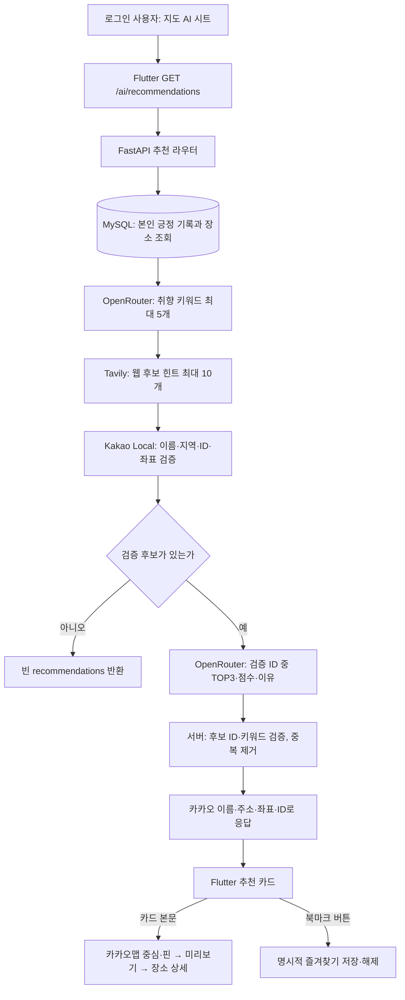

# OVERLAP AI 장소 추천 로직

> 분석 기준: `DxTeam3-fullstack-ujin`의 `feature/fullstack-ujin` 브랜치, Flutter·FastAPI 소스 정적 분석. 실제 MySQL 연결, 외부 API 호출, Android 실행은 수행하지 않았다. 아래 가상 데이터는 설명용이며 실제 사용자·카카오 장소 정보가 아니다.

## 1. 목적과 핵심 구조

OVERLAP은 사용자가 좋게 기록한 장소의 글과 감정에서 취향을 추출해 **카카오에서 확인된 실제 장소**를 제안한다. 긍정 기록에 이미 나타난 장소는 후보에서 제외한다. 역할은 분리되어 있다. **OpenRouter**는 글에서 취향 키워드를 추출하고 검증 후보의 적합도·추천 이유를 작성한다. **Tavily**는 웹에서 후보가 될 만한 이름을 찾는다. **Kakao Local**은 그 이름이 선택 지역의 실제 장소인지 확인하고 이름·주소·위도·경도·카카오 장소 ID를 제공한다. 웹페이지 제목이나 LLM이 만든 이름을 최종 장소 정보로 채택하지 않는다.

진입점은 지도 하단의 AI 추천 시트다. Flutter의 `AiRecommendationContent._load()`가 인증된 `GET /ai/recommendations`를 호출하고, FastAPI가 MySQL 읽기 → 키워드 → 웹 힌트 → 카카오 검증 → TOP3 평가 순서로 처리한다. 추천을 조회하거나 카드를 선택하는 행위만으로 장소·기록·즐겨찾기를 DB에 쓰지는 않는다. [`ai_recommendation_screen.dart:67-101`](../overlap/frontend/lib/features/ai/screens/ai_recommendation_screen.dart), [`ai_recommendations.py:42-103`](../overlap/backend-fastapi/app/ai_recommendations.py)

## 2. MySQL에서 가져오는 기록과 감정 기준

`RecordRecommendationAdapter.list_positive_records(db, user.id)`는 `records`와 `places`를 `Record.place_id = Place.id`로 외부 조인한다. 조건은 **인증 사용자 `records.author_id`와 긍정 감정 `excellent`, `good`, `okay`**다. `created_at` 내림차순, ID 내림차순으로 조회하며 건수 제한은 없다. `neutral`, `disappointed`, `poor`는 AI 입력에서 빠진다. 다른 사용자의 기록도 들어가지 않는다. [`recommendation_record_adapter.py:39-79`](../overlap/backend-fastapi/app/recommendation_record_adapter.py)

| DB 원천 | 추천용 데이터 | 실제 다음 단계 사용 |
|---|---|---|
| `records.id,author_id,place_id,content,emotion,created_at` | 기록 ID·사용자 ID·장소 ID·본문·정규화 감정·작성 시각 | OpenRouter에는 본문·감정·장소명이 전달된다. 작성 시각은 정렬에 쓰인다. |
| `places.provider,external_place_id,name,address,road_address,latitude,longitude` | `provider='kakao'`일 때 카카오 ID, 장소명, 도로명 우선 주소, 좌표 | Tavily·카카오 지역 도출, 방문 장소 제외. 위경도는 키워드·TOP3 LLM 입력에 포함되지 않는다. |

감정 표현은 `excellent→LOVE/최고`, `good→LIKE/좋아`, `okay→GOOD/괜찮아`로 매핑된다. 사진, 댓글, 좋아요, 모임명, 프로필, 부정 기록은 현재 추천 프롬프트에 넣지 않는다. `records`에 방문 날짜 컬럼은 없으므로 `visited_on=None`이며 작성일을 방문일이라고 해석하지 않는다.

## 3. OpenRouter 취향 키워드 추출

`OpenRouterPreferenceKeywordService.extract_keywords()`는 긍정 기록 각각의 `content`, `emotion_code`, `emotion_meaning`, `place_name`을 JSON으로 보낸다. 시스템 프롬프트는 **장소 분위기·환경·활동 취향에 관한 한국어 키워드 최대 5개**, 각 `score` 0~1, 단순 감정어·방문 장소명 제외, 동의어 병합을 요구한다. `json_schema` 형식, `temperature=0`, `max_tokens=300`, 요청 Timeout 30초를 사용한다. 중복 키워드와 방문 장소명 일치 키워드를 다시 제거하고 점수순 최대 5개로 정리한다. [`openrouter_preference_keyword_service.py:19-45,109-159`](../overlap/backend-fastapi/app/openrouter_preference_keyword_service.py)

모델 이름은 코드의 `OPENROUTER_MODEL` 설정값으로 결정된다. 설정이 없을 때의 **기본값은 `dots-studio/dots-3-note-preview:free`**이며, 실제 배포에서 다른 값으로 덮어썼는지는 확인하지 않았다. `LLM_PROVIDER` 기본값은 `openrouter`이고 팩토리는 이 제공자만 지원한다. [`config.py:14-18`](../overlap/backend-fastapi/app/config.py), [`provider_factory.py:7-22`](../overlap/backend-fastapi/app/provider_factory.py)

OpenRouter 요청 또는 응답 파싱이 실패하면 긍정 기록 본문에서 2자 이상 단어의 빈도를 세는 **대체 키워드 추출**을 사용한다. 장소명 토큰과 일부 감정 표현을 제외하고, 최빈 횟수 대비 비율을 0~1 점수로 삼는다. 반면 키·모델 설정 자체가 없으면 대체 실행 없이 503 오류다. 대체 키워드도 없으면 빈 추천으로 끝난다. 이 점수는 취향 강도의 간단한 입력값이지 검증된 확률이 아니다. [`openrouter_preference_keyword_service.py:87-159`](../overlap/backend-fastapi/app/openrouter_preference_keyword_service.py)

## 4. Tavily 웹 후보 검색

`TavilyPlaceSearchService`는 기록 주소가 있는 첫 항목의 첫 지역 토큰과 점수가 높은 키워드를 조합해 **최대 3개 검색 질의**를 만든다. 각 질의는 `search_depth='basic'`, `max_results=10`, Timeout 15초로 Tavily에 요청한다. 결과의 제목·URL·본문이 모두 있어야 하며 제목 앞부분에서 장소명처럼 보이는 문자열을 추출한다. 제목이 비었거나 80자를 넘거나 단순 ‘검색/명소’ 등이면 버린다. 이미 기록한 장소명·중복 이름도 제외하고 전체 후보는 최대 10개다. [`tavily_place_search_service.py:14-79`](../overlap/backend-fastapi/app/tavily_place_search_service.py)

**이 단계의 이름은 웹 검색 힌트일 뿐이다.** 후보 `address`, `latitude`, `longitude`는 `None`이다. 따라서 뉴스 제목·블로그 제목·관광 안내 페이지가 추출되더라도 카카오 검증을 통과하지 못하면 추천 카드에 표시할 수 없다. `SEARCH_PROVIDER` 기본값은 `tavily`이며 제공자 선택 팩토리도 Tavily 구현을 사용한다. [`provider_factory.py:12-17`](../overlap/backend-fastapi/app/provider_factory.py)

## 5. Kakao Local의 실제 장소 검증과 중복 제외

`KakaoPlaceVerificationService.verify()`는 긍정 기록에 있는 주소 첫 토큰 중 **가장 빈도가 높은 지역**을 목표 지역으로 정한다. Tavily 검색에 쓰는 ‘첫 주소의 지역’과 기준이 다를 수 있다. 주소가 없거나 키워드가 비면 검증 후보는 없다. [`kakao_place_verification_service.py:28-63`](../overlap/backend-fastapi/app/kakao_place_verification_service.py)

웹 힌트 최대 4개에 대해 `지역 + 힌트 이름`으로 `search_places()`를 호출한다. 카카오 응답에서 다음 조건을 모두 만족해야 채택한다.

1. 숫자 문자열의 `kakao_place_id`, 비어 있지 않은 카카오 장소명·주소·장소 URL이 있다.
2. 주소 첫 토큰이 목표 지역과 **정확히 같다**. 따라서 광주광역시 기록에서 첫 토큰이 다른 도시의 동명 장소는 제외된다.
3. 위도·경도가 유한한 숫자이며 유효 범위 안이다.
4. 웹 힌트 경로는 문장부호·공백을 제거한 **카카오 장소명과 힌트 이름이 일치**해야 한다.
5. 본인 긍정 기록의 카카오 장소 ID/정규화 장소명과 일치하거나, 이번 후보의 카카오 ID와 중복되면 제외한다.

검증 장소가 3개 미만이면 상위 키워드 최대 3개로 `지역 + 키워드` **카카오 직접 검색**을 보완한다. 이 경로도 같은 지역·ID·좌표 검사를 통과해야 하지만 웹 힌트 이름 일치 조건은 적용되지 않는다. 전체 카카오 검색은 최대 **6회**, 각 요청 Timeout **6초**, 후보는 최대 10개다. `search_places()`는 Kakao Local Keyword Search에서 한 요청당 최대 5개 문서를 받고, 카카오 응답의 `place_name`, 도로명 우선 주소, `y/x`, `id`, `place_url`을 각각 이름·주소·위도/경도·ID·URL로 변환한다. [`kakao_place_verification_service.py:17-120`](../overlap/backend-fastapi/app/kakao_place_verification_service.py), [`kakao.py:7-46`](../overlap/backend-fastapi/app/kakao.py)

**제외 범위의 한계:** 방문 중복 목록은 앞 단계에서 가져온 **긍정 기록만**으로 만든다. 중립·부정 감정으로 기록한 장소까지 모두 방문 장소로 제외하는 구현은 아니다. 지역 비교도 주소 첫 토큰 일치 방식이어서 행정구역 표기가 다르면 유효 장소를 놓칠 수 있다.

## 6. OpenRouter TOP3, 점수와 추천 이유

`OpenRouterPlaceRecommendationService.recommend()`는 키워드(`keyword,score`), 긍정 기록의 `content,emotion_meaning,place_name`, **카카오 검증 완료 후보**를 입력으로 사용한다. 모델에는 후보별 카카오 ID·이름·주소·키워드·요약·URL을 보내지만 위경도는 제외한다. 프롬프트는 후보 ID 중 서로 다른 장소 최대 3개, 0~1 `match_score`, 선호 키워드 목록에 있는 `matched_keywords`, 간결한 한국어 `reason`을 요구한다. `json_schema`, `temperature=0`, `max_tokens=900`, Timeout 45초다. [`openrouter_place_recommendation_service.py:20-48,90-126`](../overlap/backend-fastapi/app/openrouter_place_recommendation_service.py)

서버는 응답의 ID가 실제 후보 목록에 있는지, 일치 키워드가 추출 키워드 목록에 있는지 다시 확인한다. 점수 내림차순 정렬 후 카카오 ID로 중복을 제거해 최대 3개를 반환한다. **최종 `name,address,latitude,longitude,kakao_place_id`는 모델이 새로 쓴 문자열이 아니라 검증 후보에서 복사**한다. `match_score`와 `reason`은 모델 생성값이며 점수 계산식이나 추천 이유의 사실성 검증기는 별도로 없다. 점수를 통계적 방문 만족 확률로 해석하면 안 된다. `source_url` 역시 검증 이후에는 카카오 `place_url`에서 온 값이다. [`openrouter_place_recommendation_service.py:127-169`](../overlap/backend-fastapi/app/openrouter_place_recommendation_service.py)

### 가상 데이터로 보는 전달 예

아래 내용은 **형식 설명을 위한 허구의 값**이다. 실제 사용자 기록·카카오 응답·LLM 실행 결과를 인용한 것이 아니다.

| 단계 | 예시 |
|---|---|
| 본인 긍정 기록 | `emotion=good`, `content="나무길을 천천히 걷기 좋았다"`, `place_name="가상 공원 A"`, `address="광주광역시 가상구 ..."` |
| 취향 키워드 | `[{"keyword":"산책","score":0.9},{"keyword":"숲","score":0.8}]` |
| Tavily 힌트 | `name="가상 숲길 B"`, `address=null`, `latitude=null` |
| 카카오 검증 후보 | `kakao_place_id="123456789"`, `name="가상 숲길 B"`, `address="광주광역시 가상구 가상로 1"`, `latitude=35.1000000`, `longitude=126.9000000` |
| 최종 추천 | 위 카카오 ID·이름·주소·좌표 + 모델의 `match_score=0.87`, `matched_keywords=["산책","숲"]`, `reason="산책과 숲을 좋게 기록한 취향과 연결됩니다."` |

## 7. FastAPI 응답에서 Flutter 지도·상세·즐겨찾기까지

FastAPI 응답은 `{"recommendations":[...]}` 형식이며 한 항목의 주요 필드는 `rank,kakao_place_id,name,address,latitude,longitude,match_score,matched_keywords,reason,source_url`이다. Flutter `AiRecommendationsApi.load()`가 이를 `AiPlaceRecommendation` 객체로 바꾸며 응답 Timeout은 **180초**다. 현재 Flutter 모델은 `match_score`를 읽어 카드에 표시하지 않는다. 카드에는 카카오 검증 이름·주소와 키워드·AI 이유가 보인다. [`ai_recommendation_models.py:33-51`](../overlap/backend-fastapi/app/ai_recommendation_models.py), [`ai_recommendations_api.dart:4-22`](../overlap/frontend/lib/features/ai/services/ai_recommendations_api.dart), [`ai_place_recommendation.dart:1-25`](../overlap/frontend/lib/features/ai/models/ai_place_recommendation.dart)

- **카드 본문 탭:** 카카오 ID·좌표가 있을 때 `MapScreen._showRecommendedPlaceOnMap()`이 `MapSearchPlace`로 변환한다. AI 시트를 접고 Android 카카오맵 WebView의 검색 장소 핀과 중심을 갱신한 뒤, ‘AI 추천 장소’ 미리보기 Bottom Sheet를 열어 ‘장소 상세 보기’로 공통 `PlaceDetailScreen`에 이동한다. [`map_screen.dart:326-376,379-465`](../overlap/frontend/lib/features/map/screens/map_screen.dart), [`kakao_map_webview.dart:443-473`](../overlap/frontend/lib/features/map/widgets/kakao_map_webview.dart)
- **상세 진입:** `GET /places/kakao/{kakao_place_id}`로 내부 `places.id`·저장 여부·보이는 기록 수를 **읽기만** 한다. 내부 장소가 있으면 `GET /feed?place_id=...`로 기존 기록을 조회하고, 없으면 빈 기록 상태를 보여 준다. 상세는 추천 이유와 키워드도 함께 표시한다. [`place_detail_screen.dart:57-148,474-506`](../overlap/frontend/lib/features/map/screens/place_detail_screen.dart), [`saved_places.py:85-101`](../overlap/backend-fastapi/app/saved_places.py)
- **북마크 버튼 탭:** 카드 본문 이동과 별도로 처리한다. 이미 내부 장소가 있으면 `POST /places/{place_id}/saved`, 없으면 `POST /places/kakao/{kakao_place_id}/saved`로 등록한다. 신규 내부 장소 저장 시 서버가 카카오 ID·이름·지역을 다시 확인한다. 해제는 `DELETE /places/{place_id}/saved`, 목록은 `GET /places/saved`다. `SavedPlacesApi.revision`으로 카드·상세·목록의 상태 변경을 전파하고, 요청 중 중복 탭을 막으며 실패 시 재조회/안내한다. 저장은 사용자별 `saved_places` 연결이고 방문 `records`를 만들지 않는다. [`ai_place_recommendation_card.dart:60-132,134-181`](../overlap/frontend/lib/features/ai/widgets/ai_place_recommendation_card.dart), [`saved_places_api.dart:28-82`](../overlap/frontend/lib/features/user/services/saved_places_api.dart), [`saved_places.py:102-184`](../overlap/backend-fastapi/app/saved_places.py)

## 8. 빈 결과·오류 처리

| 상황 | 코드상 동작 |
|---|---|
| 본인 긍정 기록 없음, 추출 키워드 없음, 카카오 검증 후보 없음 | 각 단계에서 `recommendations=[]` 반환. Flutter는 ‘확인된 추천 장소가 없어요…’와 재시도 버튼 표시. |
| 검증 후보 1~2개 | 허위 후보로 채우지 않고 OpenRouter가 선택한 확인 장소만, 최대 3개 반환. |
| 키워드용 OpenRouter HTTP/응답 오류 | 기록 본문의 단어 빈도 기반 키워드로 대체. 대체 키워드도 없으면 빈 결과. |
| OpenRouter/Tavily/Kakao 설정 누락 | FastAPI 503. |
| Tavily·Kakao·최종 OpenRouter 요청/응답 오류, 후보 밖 ID·미등록 키워드 | FastAPI 502. 최종 순위 생성 단계에는 임의 장소를 만드는 대체 경로가 없다. |
| Flutter API 실패 | 401은 로그인 필요, 502는 추천 서비스 오류, 기타 오류는 메시지와 ‘다시 추천받기’ 표시. 기존 카드가 실패 시 화면에 남을 수 있으므로 최신 결과 여부는 재시도 후 확인한다. |
| 카드에 카카오 ID/좌표 누락 | 지도 선택 콜백을 실행하지 않는다. 서버 정상 파이프라인은 검증 후보의 ID·좌표를 사용한다. |

라우터는 제공자 오류의 원문·키 대신 단계명과 개수 중심의 진단을 기록한다. 외부 호출 상한은 요청당 **OpenRouter 최대 2회, Tavily 최대 3회, Kakao Local 추천 검증 최대 6회**다. 북마크로 신규 장소를 저장할 때의 카카오 재확인 호출은 추천 GET 흐름과 별도다. [`ai_recommendations.py:22-102`](../overlap/backend-fastapi/app/ai_recommendations.py)

## 9. 기술별 역할과 선택 근거

| 기술 | 현재 구현에서 맡는 역할 | 코드로 설명 가능한 이유 |
|---|---|---|
| MySQL·SQLAlchemy | 개인 기록과 장소의 읽기, 명시적 즐겨찾기 저장 | 인증 사용자 ID·감정 조건으로 추천 입력을 분리할 수 있다. |
| OpenRouter | 자연어 기록 → 취향 키워드, 검증 후보 → 개인화 점수·이유 | 정형 필드만으로 표현하기 어려운 글의 분위기·활동 취향을 입력으로 사용한다. |
| Tavily | 지역·취향으로 웹 힌트 수집 | 후보 탐색 범위를 넓히지만 실제 장소의 권위 있는 이름·좌표 출처로 사용하지 않는다. |
| Kakao Local | 실제 장소 존재·지역·ID·주소·좌표 검증 | 웹 제목과 생성 문구를 장소명으로 노출하지 않고 카카오 장소 자료를 지도와 연결한다. |
| Flutter·Kakao Map | 추천 카드, 지도 핀·미리보기·상세·북마크 | 검증 좌표와 카카오 ID를 사용자가 앱에서 확인한다. |

위 ‘이유’는 **코드 구조에서 추론할 수 있는 역할상의 근거**다. 특정 공급자를 다른 공급자보다 채택한 비용·정책·성능 비교 자료는 코드에서 확인되지 않았다. 또한 카카오 검색 확인은 실제 POI와 좌표를 검사하는 것이며 영업 상태나 추천 이유의 사실성을 보증하지는 않는다.

## 관련 코드와 Endpoint

| 영역 | 주요 파일·함수 |
|---|---|
| 사용자 기록 | `app/recommendation_record_adapter.py` — `list_positive_records`, `to_recommendation_record` |
| 추천 오케스트레이션 | `app/ai_recommendations.py` — `recommendations`; `app/provider_factory.py` — 제공자 생성 |
| 취향·웹·검증·순위 | `app/openrouter_preference_keyword_service.py` — `extract_keywords`; `app/tavily_place_search_service.py` — `search_candidates`; `app/kakao_place_verification_service.py` — `verify`; `app/openrouter_place_recommendation_service.py` — `recommend` |
| 장소 API/모델 | `app/kakao.py` — `search_places`; `app/ai_recommendation_models.py` — 요청 중간/최종 응답 DTO; `app/saved_places.py` — 북마크 조회·저장·해제 |
| Flutter | `features/ai/screens/ai_recommendation_screen.dart`, `features/ai/services/ai_recommendations_api.dart`, `features/ai/widgets/ai_place_recommendation_card.dart`, `features/map/screens/map_screen.dart`, `features/map/screens/place_detail_screen.dart` |

| Method | Endpoint | 쓰임 |
|---|---|---|
| GET | `/ai/recommendations` | 인증 사용자의 추천 생성·조회 |
| GET | `/places/kakao/{kakao_place_id}` | 내부 장소·저장 상태·보이는 기록 수 조회, 쓰기 없음 |
| GET | `/feed?place_id={place_id}` | 해당 장소의 접근 가능한 기록 조회 |
| POST | `/places/kakao/{kakao_place_id}/saved` | 신규 카카오 장소 재확인 뒤 즐겨찾기 |
| GET/POST/DELETE | `/places/{place_id}/saved` | 내부 장소 저장 상태 조회·등록·해제 |
| GET | `/places/saved` | 로그인 사용자 즐겨찾기 목록 |

위 경로는 `app/main.py:768-785`에 등록된 실제 FastAPI 라우터 기준이다. 추천 단계에서 카카오 Local은 내부 서비스가 직접 호출하며, 지도 장소 검색용 `GET /places/search`는 별도의 사용자 검색 API다.
