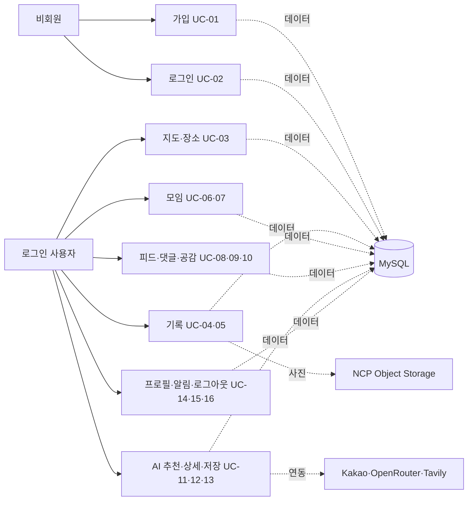
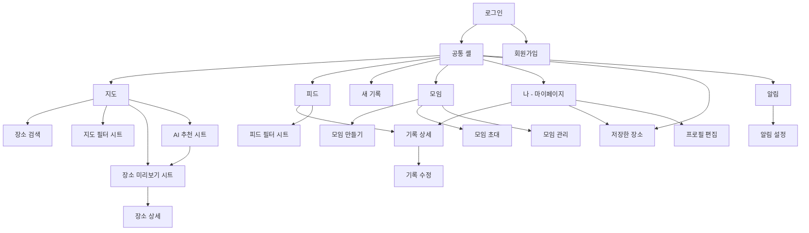
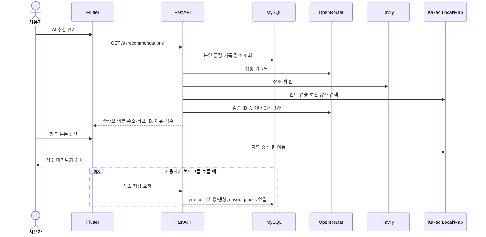
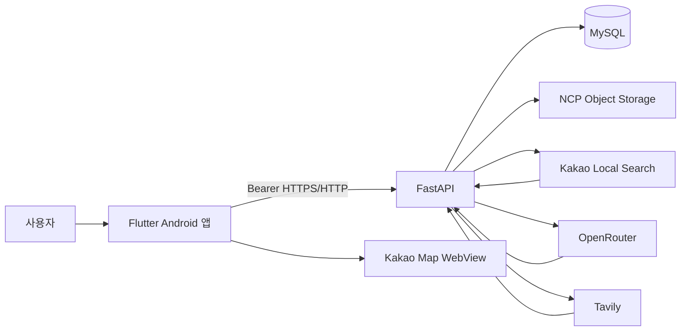
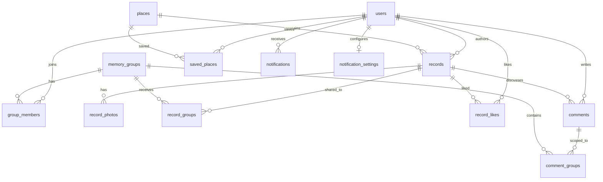

# OVERLAP 산출물 제작 통합 참고서

> 분석 대상: `DxTeam3-fullstack-ujin` / `feature/fullstack-ujin`. 본 문서는 정적 소스 분석 결과이며, 실제 MySQL 접속·외부 API·Android 앱 실행 검증은 수행하지 않았다.

## 문서 사용법과 판정 기준

- 전체 경로는 저장소 루트 기준이다. 짧게 적은 `main.py`, `records.py` 등 백엔드 파일명은 `overlap/backend-fastapi/app/` 아래를, `features/...`는 `overlap/frontend/lib/` 아래를 뜻한다. 근거 위치는 `경로:줄`로 표시한다. ID는 **기능 F / 유스케이스 UC / 화면 S / API A / 메뉴 M**으로 고정한다.
- **[구현 완료]** 화면과 API·서비스 또는 해당 화면의 로컬 동작이 코드로 연결됨. 운영 환경 정상 작동을 보증하는 의미는 아니다. **[부분 구현]** 화면이나 API 일부만 연결됨. **[미구현]** 버튼이 안내만 하거나 해당 흐름이 없음. **[확인 필요]** 소스만으로 배포 설정·실제 데이터·단말 결과를 판정할 수 없음.
- `overlap/README.md`에는 초기 Spring Boot·별도 AI 서버 구성이 적혀 있으나, 본 브랜치의 실제 Flutter API 연결과 FastAPI 라우터는 `overlap/frontend/lib`, `overlap/backend-fastapi/app` 기준이다. 기획 문서와 현재 실행 경로를 혼동하지 않는다.

# Ⅰ. 프로젝트 개요

| 항목 | 확인된 내용 |
|---|---|
| 프로젝트·목적 | **OVERLAP**. 지인들이 장소를 중심으로 사진·글·감정을 기록하고, 공유된 모임 기록을 지도와 피드에서 함께 보는 서비스다. 앱 진입점은 `overlap/frontend/lib/main.dart:9`, 하단 탭은 `features/home/screens/app_shell_screen.dart:25`이다. |
| 추진 배경 | 장소별로 여러 사람의 기억을 모아 보고, 개인 기록에서 새 방문 후보를 찾는 문제를 다룬다는 방향은 코드와 프로젝트 설명에서 확인된다. 수요 규모·성과·기존 서비스 대비 우위는 자료로 확인되지 않는다. |
| 주요 사용자 | 회원가입 후 로그인한 일반 사용자. 모임 생성자도 `group_members`의 회원으로 등록되며 별도 방장 역할 컬럼이나 관리 권한을 임의로 가정하지 않는다. |
| 핵심 개념 | `places`의 장소 하나에 여러 `records`가 연결되고, `record_groups`로 모임 공유 범위를 정한다. 기록이 없는 추천 장소도 지도·상세로 볼 수 있다. |
| 차별 요소(구현 관찰) | 장소별 기록 집계와 핀, 모임별 공유/필터, 감정이 긍정인 개인 기록에서 시작하는 추천, 카카오 장소 ID 검증 후 지도와 즐겨찾기 연결. 시장 경쟁력은 별도 조사 필요. |
| 전체 이용 흐름 | 회원가입/로그인 → 지도·장소 탐색 또는 기록 작성 → 피드·모임에서 기록 열람/상호작용 → 개인 기록 기반 AI 장소 추천 → 카카오맵에서 후보 확인 → 명시적 북마크 저장. |
| 실제 연결 기술 | Flutter/Dart, FastAPI/Pydantic/SQLAlchemy, MySQL, Android Kakao Map WebView, Kakao Local, NCP Object Storage, OpenRouter, Tavily. 의존 경로: `features/map/widgets/kakao_map_webview.dart`, `backend-fastapi/app/{records.py,ai_recommendations.py,object_storage.py}`. |

# Ⅱ. 전체 기능 목록

표의 화면 ID는 Ⅶ절에서 정의한다. 로컬 위젯 동작도 기능으로 세되, 서버 영속성과 구분한다.

| 기능 ID | 대분류 | 중분류 | 세부 기능 | 기능 설명 | 구현 상태 | 관련 화면 |
|---|---|---|---|---|---|---|
| F-01 | 인증 | 가입 | 회원가입 | 이메일·비밀번호·닉네임·생년월일·성별 입력 후 계정 생성 | [구현 완료] | S-02 |
| F-02 | 인증 | 세션 | 로그인·만료 처리 | 로그인 토큰을 앱 실행 중 보관, 필요한 화면에서 `/auth/me` 확인, 만료 시 로그인 이동 | [구현 완료] | S-01, S-03 |
| F-03 | 인증 | 세션 | 로그아웃 | 확인 대화상자 뒤 세션 종료 | [구현 완료] | S-17 |
| F-04 | 인증 | 계정 복구 | 이메일·비밀번호 찾기 | 안내 스낵바만 표시 | [미구현] | S-01 |
| F-05 | 지도 | 탐색 | 카카오맵·현재 위치 | Android 지도 WebView와 현위치 버튼 | [구현 완료] | S-03 |
| F-06 | 지도 | 탐색 | 기록 핀·모임 필터 | 접근 가능한 기록 장소 핀, 내 기록/모임 필터 | [구현 완료] | S-03, S-05 |
| F-07 | 장소 | 검색 | 카카오 장소 키워드 검색 | 장소·주소 검색 후 지도 좌표 선택 | [구현 완료] | S-04, S-03 |
| F-08 | 장소 | 조회 | 장소 미리보기·상세 | 기록 장소와 AI 후보의 다른 미리보기, 공통 상세 화면 | [구현 완료] | S-06, S-07 |
| F-09 | 기록 | 생성 | 사진·장소·감정·글 작성 | 사진 1~5장, 카카오 장소, 감정, 공유 범위 저장 | [구현 완료] | S-08 |
| F-10 | 기록 | 공유 | 나만 보기·모임 선택 | 개인 또는 가입 모임 하나 이상 공유 | [구현 완료] | S-08, S-10 |
| F-11 | 기록 | 조회 | 기록 상세·사진 | 보이는 기록과 작성자·사진·감정·댓글 표시 | [구현 완료] | S-09, S-07 |
| F-12 | 기록 | 변경 | 기록 수정·삭제 | 작성자만 내용·감정·범위 수정, 삭제 확인 | [구현 완료] | S-09, S-10 |
| F-13 | 피드 | 조회 | 피드·필터 | 내 기록/모임 공유 기록을 목록 및 필터로 조회 | [구현 완료] | S-11 |
| F-14 | 피드 | 이동 | 피드 카드 장소 상세 | 장소 이름 탭은 추후 안내만 표시 | [부분 구현] | S-11 |
| F-15 | 모임 | 가입 | 모임 생성·초대코드 | 생성 시 자동 가입, 초대코드 복사·참여 | [구현 완료] | S-12, S-13, S-14 |
| F-16 | 모임 | 조회 | 내 모임·멤버 | 내 모임 목록·멤버 수와 멤버 정보 | [구현 완료] | S-12, S-15 |
| F-17 | 모임 | 설정 | 별칭·알림·핀 색·탈퇴 | 사용자별 설정 및 모임 탈퇴 | [구현 완료] | S-15 |
| F-18 | 댓글 | 상호작용 | 댓글·답글·삭제 | 기록의 모임 문맥에 맞는 댓글·답글, 본인 댓글 삭제 | [구현 완료] | S-09 |
| F-19 | 반응 | 좋아요 | 공감 등록·해제 | 기록별 사용자 좋아요와 개수 | [구현 완료] | S-09, S-11, S-07 |
| F-20 | AI | 개인화 | 긍정 기록·키워드 추출 | 본인 긍정 기록을 OpenRouter 입력으로 변환 | [구현 완료] | S-03, S-16 |
| F-21 | AI | 후보 | Tavily 후보·카카오 검증 | 웹 힌트를 실제 카카오 장소·지역·좌표로 확인 | [구현 완료] | S-16 |
| F-22 | AI | 추천 | TOP3·이유·키워드 | 검증된 ID 안에서 최대 3개 선정·점수·이유 출력 | [구현 완료] | S-16 |
| F-23 | AI | 지도 연동 | 추천 카드→핀→상세 | 시트 접기, 지도 이동, 미리보기, 공통 상세 | [구현 완료] | S-16, S-03, S-06, S-07 |
| F-24 | 즐겨찾기 | 저장 | 카드·상세 북마크 | 카카오 ID 확인 후 사용자별 장소 저장·해제 | [구현 완료] | S-16, S-07 |
| F-25 | 즐겨찾기 | 조회 | 저장한 장소 목록 | 상단 버튼 또는 마이페이지 탭에서 조회·해제 | [구현 완료] | S-18, S-17 |
| F-26 | 마이페이지 | 조회 | 프로필·내 기록·내 지도 | 사용자 정보와 내 기록, 지도 탭 이동 | [구현 완료] | S-17 |
| F-27 | 마이페이지 | 수정 | 프로필·사진 변경 | 닉네임 등과 사진 업로드·삭제 | [구현 완료] | S-19 |
| F-28 | 알림 | 조회 | 목록·읽음 | 새 기록/댓글·답글/반응 등 생성된 알림 목록과 읽음 처리 | [구현 완료] | S-20 |
| F-29 | 알림 | 설정 | 항목별 수신 설정 | 서버 설정 조회·수정, 조용한 시간 선택 | [구현 완료] | S-21 |
| F-30 | 알림 | 근처 알림 | 위치 기반 리마인더 | 설정 항목은 있으나 위치 권한 연동은 추후 안내 | [부분 구현] | S-21 |
| F-31 | 공유 카드 | 생성·공유 | 카드 표시·외부 앱 공유 | Mock 카드와 완료 안내, 외부 공유는 추후 문구 | [부분 구현] | S-22 |
| F-32 | 지도 | 플랫폼 | iOS·웹 실지도 | Android 이외에는 그림 placeholder | [미구현] | S-03 |

근거: 화면 목록 `overlap/frontend/lib/features/**/screens`, API 연결은 `features/**/services`; 모델은 `overlap/backend-fastapi/app/{record_models.py,group_db_models.py,notification_models.py}`. F-04는 `login_screen.dart:205`, F-14는 `feed_screen.dart:300`, F-31은 `share_card_screen.dart:13`, F-32는 `map_view.dart:35`를 참조한다.

# Ⅲ. 유스케이스 다이어그램 작성 자료

## Actor와 시스템 경계

| 유형 | 명칭 | 역할·권한 |
|---|---|---|
| 사람 | 비회원 | 회원가입·로그인만 수행. 인증이 필요한 앱 영역은 토큰 없이는 접근 불가. |
| 사람 | 로그인 사용자 | 지도·장소·기록·모임·피드·댓글·AI·즐겨찾기·프로필·알림 사용. 본인 기록 수정/삭제, 본인 댓글 삭제. 모임 공유 기록은 가입 관계로 가시성 판단. |
| 외부 시스템 | Kakao Local·Kakao Map | 장소 검색/검증과 Android 지도 표현. 사용자 Actor가 아니라 시스템 연동 상대. |
| 외부 시스템 | OpenRouter·Tavily | 취향 키워드와 TOP3 평가, 웹 검색 힌트. |
| 외부 시스템 | NCP Object Storage | 기록·프로필 사진 파일 저장/조회. |
| 데이터 저장소 | MySQL | 사용자·장소·기록·모임·상호작용·알림 영속화. |

시스템 경계는 Flutter 클라이언트와 FastAPI 서버를 합친 **OVERLAP 서비스**다. 목록의 사용자 기능 API는 Bearer 사용자 식별을 사용하며 가입/로그인과 루트·헬스 확인만 예외다. 카카오 장소 검색 `/places/search`도 `current_user` 의존성이 있다. 근거: `main.py:128-158,193-254`.

| Actor | Use Case | 연결/관계 | 조건 |
|---|---|---|---|
| 비회원 | UC-01 회원가입, UC-02 로그인 | 직접 | 이메일 등 유효성 검사 |
| 로그인 사용자 | UC-03 장소 탐색, UC-04 기록 작성, UC-05 기록 조회·수정·삭제 | 직접 | 기록 범위와 작성자 권한 |
| 로그인 사용자 | UC-06 모임 생성·참여, UC-07 모임 관리 | 직접 | 가입 모임 |
| 로그인 사용자 | UC-08 피드 조회, UC-09 댓글·답글, UC-10 공감 | 직접 | 보이는 기록 |
| 로그인 사용자 | UC-11 AI 추천, UC-12 추천 장소 지도·상세, UC-13 즐겨찾기 | 직접 | 긍정 기록/검증된 카카오 장소 |
| 로그인 사용자 | UC-14 프로필·사진, UC-15 알림, UC-16 로그아웃 | 직접 | 본인 계정 |
| UC-04 | UC-03 장소 선택, UC-06 모임 선택 | «include»로 표현 가능 | 사진·감정·카카오 장소 필수. 비공개일 때 모임 선택은 생략. |
| UC-09 | 답글 작성 | «extend»로 표현 가능 | 답글 대상 댓글 선택 시 |
| UC-12 | UC-13 북마크 | «extend»로 표현 가능 | 사용자가 명시적으로 누를 때만 저장 |



위 그림은 draw.io에서 **정식 UML 유스케이스 다이어그램으로 옮기기 위한 관계 초안**이다. Mermaid flowchart 자체가 UML 표준 유스케이스 표기는 아니다. 외부 API·DB는 시스템 연동 상자로 따로 배치한다.

# Ⅳ. 유스케이스 명세서

아래 **관련 API**의 A 번호는 Ⅷ절, **관련 화면**의 S 번호는 Ⅶ절과 동일하다. 기본 흐름은 실제 Flutter 경로, 대안·예외는 코드에서 확인된 분기만 기재했다.

## UC-01 회원가입

| 항목 | 명세 |
|---|---|
| 목적/Actor/상태 | 계정 생성 / 비회원 / [구현 완료] |
| 화면/사전 조건/트리거 | S-01→S-02 / 가입하지 않은 사용자 / ‘계정이 없나요? 회원가입’ |
| 기본 흐름 | 1. 회원가입 화면에 진입한다. 2. 이메일, 비밀번호·확인, 표시 이름, 생년월일, 성별을 입력하고 동의 항목을 확인한다. 3. ‘회원가입’을 누른다. 4. 앱이 입력을 검사하고 A-01을 호출한다. 5. 서버가 `users`에 해시 비밀번호와 프로필 값을 저장한다. 6. 완료 후 로그인 화면에 이메일을 전달한다. |
| 대안 흐름 | 뒤로가기로 가입을 취소한다. |
| 예외 흐름 | 형식·비밀번호 일치·동의 검사 실패, 중복 이메일 또는 서버 오류는 메시지로 안내하고 가입 화면에 남는다. |
| 사후 조건/API/DB | 사용자 계정 생성 / A-01 / `users`. 근거: `signup_screen.dart:47-126`, `main.py:210`. |

## UC-02 로그인·세션 만료 처리

| 항목 | 명세 |
|---|---|
| 목적/Actor/상태 | 인증 후 앱 진입 / 비회원 / [구현 완료] |
| 화면/사전 조건/트리거 | S-01→S-03 / 등록된 계정 / ‘로그인’ |
| 기본 흐름 | 1. 이메일·비밀번호 입력. 2. 앱이 A-02로 토큰 요청. 3. 토큰을 보관하고 `AppShellScreen`으로 이동해 지도 탭을 표시한다. 4. 마이페이지 등 사용자 정보를 표시하는 화면에서 A-03을 호출한다. |
| 대안 흐름 | 가입 화면으로 이동한다. |
| 예외 흐름 | 인증 오류는 스낵바 표시. 인증 만료는 전역 세션 리비전 리스너가 로그인 화면으로 경로를 교체한다. 이메일·비밀번호 찾기는 안내만 제공한다. |
| 사후 조건/API/DB | 인증 세션 활성화 / A-02, A-03 / `users`. 근거: `login_screen.dart:40-80`, `main.dart:21-38`. |

## UC-03 지도·장소 탐색

| 항목 | 명세 |
|---|---|
| 목적/Actor/상태 | 기록 장소·외부 장소 확인 / 로그인 사용자 / [구현 완료] |
| 화면/사전 조건/트리거 | S-03→S-04/S-05/S-06/S-07 / 토큰·지도 사용 환경 / 지도 탭·검색·핀 |
| 기본 흐름 | 1. 지도 탭이 A-14로 접근 가능한 장소 핀을 받는다. 2. 사용자가 검색창에서 카카오 장소를 검색(A-16)하거나 기록 핀을 누른다. 3. 검색 선택 시 좌표로 중심과 검색 핀이 이동한다. 4. 기록 핀은 S-06 미리보기를 열고 ‘장소 상세 보기’가 S-07로 이동한다. 5. 상세가 A-15 피드의 `place_id` 필터로 기록을 가져온다. |
| 대안 흐름 | 내 기록/모임 필터 S-05 선택, 현재 위치 버튼. 검색 결과를 선택하지 않고 복귀 가능. |
| 예외 흐름 | 검색 실패·좌표 누락·위치 권한 불가 시 안내. Android 외 플랫폼은 실지도 대신 placeholder. |
| 사후 조건/API/DB | 지도 선택 상태만 변경; 장소나 기록은 저장하지 않음 / A-14~A-16, A-15 / `places,records,record_groups,group_members`. 근거: `map_screen.dart:193-379`, `map_view.dart:35`. |

## UC-04 기록 작성

| 항목 | 명세 |
|---|---|
| 목적/Actor/상태 | 장소에 사진·감정·글을 남김 / 로그인 사용자 / [구현 완료] |
| 화면/사전 조건/트리거 | S-08 / 로그인, 카카오 장소 선택 가능 / 하단 ‘새 기록’ |
| 기본 흐름 | 1. 카메라나 갤러리에서 사진 1~5장을 고른다. 2. 감정을 선택한다. 3. 지도/검색에서 카카오 장소와 좌표를 확정한다. 4. 선택적으로 글을 입력한다. 5. ‘나만 보기’ 또는 가입 모임 하나 이상을 선택한다. 6. ‘기록 남기기’를 누른다. 7. 앱이 사진과 JSON 데이터의 multipart A-17을 전송한다. 8. 서버는 회원/파일을 검증하고 `places`를 재사용 또는 생성한 뒤 `records`, `record_photos`, `record_groups`를 저장하고 사진을 NCP에 업로드한다. 9. 성공 후 입력을 비우고 피드 탭으로 이동한다. |
| 대안 흐름 | 비공개는 모임 선택 없이 저장. Android 지도에서 핀 탭/이동 후 장소 검색을 사용할 수 있다. |
| 예외 흐름 | 사진 없음, 감정 없음, 유효 카카오 ID 없음, 공유 모임 없음이면 앱에서 중단. 서버는 사진 크기·형식, 모임 가입 권한을 검사하고 업로드/DB 실패 시 롤백·업로드 보상 삭제를 시도한다. |
| 사후 조건/API/DB | 기록·사진·공유 링크 생성, 지도·피드 리비전 갱신 / A-16~A-18, A-17 / `places,records,record_photos,record_groups,group_members,notifications`. 근거: `record_compose_screen.dart:153-503`, `records.py:260-335`. |

## UC-05 기록 조회·수정·삭제

| 항목 | 명세 |
|---|---|
| 목적/Actor/상태 | 기록 열람과 작성자 변경 / 로그인 사용자 / [구현 완료] |
| 화면/사전 조건/트리거 | S-09→S-10 / 보이는 기록, 수정·삭제는 작성자 / 피드·장소·프로필 카드 |
| 기본 흐름 | 1. 기록 카드를 눌러 사진·내용·감정·작성자와 댓글을 본다. 2. 작성자가 메뉴의 ‘수정’을 누르면 S-10에서 내용·감정·공개 범위·모임을 바꿔 A-18을 호출한다. 3. ‘삭제’는 확인 대화상자를 거쳐 A-19를 호출한다. 4. 서버가 작성자 권한을 검사하고 저장 또는 삭제한다. |
| 대안 흐름 | 수정 취소. 사진·장소는 수정 화면에서 유지되며 바꾸지 않는다. |
| 예외 흐름 | 권한 없음 403, 기록 없음 404, 범위·모임 검증 실패 422, 서버 실패 안내. 삭제 시 연결 사진의 Object Storage 정리는 DB 커밋 뒤에 수행한다. |
| 사후 조건/API/DB | 변경 또는 삭제 반영 / A-15, A-18~A-21 / `records,record_photos,record_groups,places`. 근거: `record_detail_screen.dart:210-260`, `record_edit_screen.dart:115-148`, `records.py:337-456`. |

## UC-06 모임 생성·참여

| 항목 | 명세 |
|---|---|
| 목적/Actor/상태 | 함께 기록할 모임 마련 / 로그인 사용자 / [구현 완료] |
| 화면/사전 조건/트리거 | S-12→S-13/S-14 / 토큰 / ‘모임 만들기’ 또는 ‘모임 참여’ |
| 기본 흐름 | 1. 모임 이름·소개를 입력하고 생성(A-08)한다. 2. 서버가 고유 초대코드를 생성하고 생성자를 `group_members`에 추가한다. 3. 완료 시트에서 초대코드를 복사한다. 4. 다른 사용자가 모임 목록에서 코드를 입력하고 S-14 확인 화면의 ‘코드로 모임 참여하기’를 누른다(A-10). 5. 두 사용자 목록에 모임이 나타난다(A-11). A-09 검증 API는 선언되어 있으나 현재 Flutter 참여 화면에서 호출하지 않는다. |
| 대안 흐름 | 이미 가입한 모임의 공유 버튼으로 초대코드(A-13)를 복사한다. |
| 예외 흐름 | 코드 불일치, 이미 가입, 이름 검증 또는 서버 오류는 화면 메시지. |
| 사후 조건/API/DB | 모임·가입 관계 생성 / A-08,A-10,A-11,A-13; A-09는 UI 미호출 / `memory_groups,group_members`. 근거: `create_group_screen.dart:30-135`, `join_group_screen.dart:25-39`, `group_service.py:54-95`. |

## UC-07 모임 관리

| 항목 | 명세 |
|---|---|
| 목적/Actor/상태 | 가입 모임의 개인 설정·멤버 확인 / 로그인 사용자 / [구현 완료] |
| 화면/사전 조건/트리거 | S-12→S-15 / 해당 모임 가입 / 모임 카드 탭 |
| 기본 흐름 | 1. 모임 관리에서 이름·설명·멤버 수·통계를 본다. 2. 멤버 목록 A-12를 가져온다. 3. 별칭, 알림 켜기/끄기, 핀 색상은 A-14G로 저장한다. 4. 탈퇴를 선택하면 확인 후 A-15G로 본인 가입 관계를 해제한다. |
| 대안 흐름 | 입력 편집을 취소하거나 목록을 새로고침한다. |
| 예외 흐름 | 멤버 로딩 실패 시 재시도, 모임 부재/권한 없음/저장 실패 시 안내. 별칭은 모임 전체 이름 변경이 아니라 사용자별 `custom_name`이다. |
| 사후 조건/API/DB | 가입자 설정 또는 가입 관계 갱신 / A-11~A-15G / `memory_groups,group_members`. 근거: `group_detail_management_screen.dart:58-224,226-425`. |

## UC-08 피드 조회

| 항목 | 명세 |
|---|---|
| 목적/Actor/상태 | 접근 가능한 기록 목록 열람 / 로그인 사용자 / [구현 완료] |
| 화면/사전 조건/트리거 | S-11 / 토큰 / 하단 ‘피드’ |
| 기본 흐름 | 1. 화면이 A-15를 호출한다. 2. 서버가 본인 기록 또는 가입 모임에 공유된 기록만 조회한다. 3. 카드에 사진·감정·작성자·장소·공감·댓글을 표시한다. 4. 필터 시트를 열어 전체/내 기록/모임을 골라 다시 조회한다. 5. 카드를 눌러 S-09로 이동한다. |
| 대안 흐름 | 빈 목록 안내, 재시도 버튼. |
| 예외 흐름 | 모임 권한 403 또는 네트워크 실패는 오류 안내. 카드의 장소명 탭은 상세로 연결되지 않고 안내만 한다. |
| 사후 조건/API/DB | 목록 조회만 수행 / A-15, A-20~A-21 / `records,record_groups,group_members,places,record_photos`. 근거: `feed_screen.dart:68-300`, `records.py:458-494`. |

## UC-09 댓글·답글

| 항목 | 명세 |
|---|---|
| 목적/Actor/상태 | 같은 기록에 대화 남김 / 로그인 사용자 / [구현 완료] |
| 화면/사전 조건/트리거 | S-09 / 기록 열람 권한 / 댓글 입력·답글 선택 |
| 기본 흐름 | 1. 상세 진입 시 A-24로 댓글을 불러온다. 2. 입력창에 내용을 입력하고 전송(A-25)한다. 3. 답글은 부모 댓글 ID를 포함한다. 4. 서버가 기록 가시성과 모임 공유 문맥을 확인해 `comments`와 필요 시 `comment_groups`를 저장한다. 5. 작성자는 댓글 삭제(A-27)를 할 수 있다. |
| 대안 흐름 | 개인 기록 댓글은 `group_id` 없이 처리. 공유 기록의 댓글은 현재 모임 문맥 또는 접근 가능한 모임 범위로 조회. 기록 작성자는 전체 범위 조회가 가능하다. |
| 예외 흐름 | 다른 사용자의 댓글 삭제 403, 답글이 달린 부모 삭제 409, 잘못된 모임 문맥 422/403, 실패 시 댓글 오류·재시도. |
| 사후 조건/API/DB | 댓글·답글 및 해당 알림 생성 또는 본인 댓글 삭제 / A-24~A-27 / `comments,comment_groups,records,record_groups,notifications`. 근거: `record_detail_screen.dart:95-197`, `comments.py:122-238`. |

## UC-10 기록 공감

| 항목 | 명세 |
|---|---|
| 목적/Actor/상태 | 보이는 기록에 공감 표시 / 로그인 사용자 / [구현 완료] |
| 화면/사전 조건/트리거 | S-09/S-11/S-07 / 기록 열람 권한 / 공감 아이콘 |
| 기본 흐름 | 1. 카드·상세가 A-20의 현재 상태를 확인한다. 2. 빈 공감을 누르면 A-21, 채워진 공감을 누르면 A-22를 호출한다. 3. 서버가 `record_likes`를 등록/해제하고 수를 반환한다. 4. UI가 상태를 갱신한다. |
| 대안 흐름 | 이미 등록된 공감의 중복 요청은 동일 상태로 처리. |
| 예외 흐름 | 보이지 않는 기록은 접근 불가, 네트워크 오류는 안내 및 재조회. |
| 사후 조건/API/DB | 사용자·기록별 공감 상태 반영 / A-20~A-22 / `record_likes,records,notifications`. 근거: `records.py:231-258`, `record_detail_screen.dart:109-142`. |

## UC-11 개인화 AI 장소 추천

| 항목 | 명세 |
|---|---|
| 목적/Actor/상태 | 본인 긍정 기록을 토대로 실제 새 장소 후보 제시 / 로그인 사용자 / [구현 완료] |
| 화면/사전 조건/트리거 | S-03 내 S-16 / MySQL·외부 제공자 설정 / AI 시트 열기·재추천 |
| 기본 흐름 | 1. Flutter가 A-28을 호출한다. 2. 서버가 인증 사용자 ID로 `excellent/good/okay` 기록과 장소를 조회한다. 3. OpenRouter가 취향 키워드를 추출한다. 4. Tavily가 지역·키워드로 웹 힌트를 찾는다. 5. Kakao Local이 힌트의 실제 장소명·주소·좌표·ID를 검증하고 부족하면 키워드 직접 검색을 시도한다. 6. OpenRouter가 검증 ID 목록에서 최대 3곳을 선택해 점수·키워드·이유를 작성한다. 7. 서버가 ID·키워드를 다시 검증하고 카카오의 이름·주소·좌표로 응답한다. 8. 카드가 결과를 표시한다. |
| 대안 흐름 | 긍정 기록/키워드/검증 후보가 없으면 빈 추천. 3개 미만이면 확인된 수만 반환한다. |
| 예외 흐름 | 제공자 설정 누락 503, 요청·응답 오류 502, Flutter는 오류와 ‘다시 추천받기’를 표시한다. 실제 추천의 품질과 장소 영업 상태는 실행 확인 필요. |
| 사후 조건/API/DB | 조회 및 화면 표시만 수행; 추천 자체는 DB 저장 안 함 / A-28 / `records,places,users` 읽기. 근거: `ai_recommendations.py:50-102`, `recommendation_record_adapter.py:39-79`, `openrouter_place_recommendation_service.py:90-167`. |

## UC-12 AI 추천 장소 지도·상세

| 항목 | 명세 |
|---|---|
| 목적/Actor/상태 | 추천 장소의 실제 위치·이유 확인 / 로그인 사용자 / [구현 완료] |
| 화면/사전 조건/트리거 | S-16→S-03→S-06→S-07 / 카카오 ID·유효 좌표 보유 / 카드 본문 탭 |
| 기본 흐름 | 1. 카드 본문을 누른다. 2. `MapScreen`이 검색 장소 객체로 좌표·ID를 전달하고 AI 시트를 접는다. 3. 지도 중앙과 핀이 해당 후보로 이동한다. 4. ‘AI 추천 장소’ 미리보기에서 이름·주소를 본다. 5. ‘장소 상세 보기’를 누르면 공통 상세에서 AI 이유·키워드와 기록 영역을 본다. 6. A-29로 내부 장소 존재·저장 여부를 조회하고, 존재하면 A-15로 기록을 읽는다. |
| 대안 흐름 | 기록이 0개면 ‘이 장소에 아직 기록이 없어요.’ 표시. |
| 예외 흐름 | 카카오 ID·좌표 없음이면 카드 이동 동작 중단. 상세 조회 실패 시 재시도. 추천 이름·주소·좌표는 LLM 생성값이 아닌 검증 후보에서 온다. |
| 사후 조건/API/DB | 지도·화면 상태만 변경; 자동 기록/즐겨찾기 저장 없음 / A-29, A-15 / `places,records,saved_places` 읽기. 근거: `map_screen.dart:326-376`, `place_detail_screen.dart:73-150`. |

## UC-13 장소 즐겨찾기

| 항목 | 명세 |
|---|---|
| 목적/Actor/상태 | 관심 장소를 본인 목록에 보관 / 로그인 사용자 / [구현 완료] |
| 화면/사전 조건/트리거 | S-16/S-07→S-18 / 카카오 검증 ID 또는 내부 장소 ID / 북마크 아이콘 |
| 기본 흐름 | 1. 카드 또는 상세가 A-29/A-32로 저장 상태를 조회한다. 2. 빈 북마크 클릭 시 이미 `places`에 있으면 A-33, 미등록 카카오 후보면 A-30을 호출한다. 3. 서버가 카카오 ID·이름·지역을 검증하고 필요한 경우에만 `places`를 생성한 뒤 `saved_places` 연결을 만든다. 4. 채워진 북마크 클릭 시 A-34로 사용자 연결만 삭제한다. 5. A-31 목록에 반영된다. |
| 대안 흐름 | 중복 등록은 현재 저장 상태를 반환. 카드 북마크 터치는 카드 본문 이동을 유발하지 않는다. |
| 예외 흐름 | 검증 불일치 422, 검색/서버 오류 502/503; UI는 상태를 임의 확정하지 않고 오류를 표시한다. |
| 사후 조건/API/DB | 사용자별 저장 관계 생성/해제; 기록 생성 없음 / A-29~A-34 / `places,saved_places`. 근거: `saved_places.py:85-184`, `ai_place_recommendation_card.dart:65-132`, `saved_screen.dart:48-104`. |

## UC-14 프로필 조회·수정

| 항목 | 명세 |
|---|---|
| 목적/Actor/상태 | 내 계정 정보·사진·기록 관리 / 로그인 사용자 / [구현 완료] |
| 화면/사전 조건/트리거 | S-17→S-19 / 토큰 / 마이페이지 프로필 탭 |
| 기본 흐름 | 1. S-17이 A-03, A-15(`mine`)와 모임 목록을 불러온다. 2. 프로필을 눌러 S-19에서 닉네임·생일·성별 등을 수정하고 A-04로 저장한다. 3. 사진 변경/삭제는 A-05/A-07, 표시는 A-06이다. 4. 내 기록 카드에서 S-09로 이동할 수 있다. |
| 대안 흐름 | ‘내 지도’는 지도 탭의 내 기록 필터로 이동, ‘저장한 장소’는 같은 마이페이지 내 임베드 목록을 보인다. |
| 예외 흐름 | 입력 검증·사진 형식/크기 오류 및 API 실패를 표시하고 현재 화면 유지. |
| 사후 조건/API/DB | `users` 프로필 값과 Object Storage 사진 키 갱신 / A-03~A-07, A-15 / `users,records,group_members`. 근거: `profile_screen.dart:69-201,249-326`, `profile_edit_screen.dart:70-200`. |

## UC-15 알림 조회·설정

| 항목 | 명세 |
|---|---|
| 목적/Actor/상태 | 활동 소식 확인과 수신 설정 / 로그인 사용자 / [구현 완료], 근처 알림 연동은 [부분 구현] |
| 화면/사전 조건/트리거 | S-20→S-21 / 토큰 / 상단 알림 아이콘 |
| 기본 흐름 | 1. 앱이 A-35/A-36으로 목록·미읽음 수를 가져온다. 2. 항목 선택 시 A-37로 읽음 처리하고 기록·모임 참조를 열며, 전체 읽음은 A-38을 호출한다. 3. 설정 화면이 A-39를 불러오고 스위치·조용한 시간을 바꾸면 A-40으로 저장한다. |
| 대안 흐름 | 관련 기록이 삭제되었거나 접근 불가면 안내. 목록이 없으면 빈 상태 표시. |
| 예외 흐름 | 로딩/저장 실패 시 재시도. ‘근처 알림’은 UI에 있으나 위치 권한 연동은 추후 안내다. |
| 사후 조건/API/DB | 알림 읽음·사용자 설정 갱신 / A-35~A-40 / `notifications,notification_settings`. 근거: `notifications_screen.dart:30-170`, `notification_settings_screen.dart:31-75,160-170`. |

## UC-16 로그아웃

| 항목 | 명세 |
|---|---|
| 목적/Actor/상태 | 현재 로그인 종료 / 로그인 사용자 / [구현 완료] |
| 화면/사전 조건/트리거 | S-19→S-01 / 토큰 / ‘로그아웃’ |
| 기본 흐름 | 1. 프로필 편집에서 로그아웃을 누른다. 2. 확인 대화상자에서 확정한다. 3. 앱이 A-41을 호출하고 로컬 토큰을 비운다. 4. 로그인 화면으로 스택을 교체한다. |
| 대안 흐름 | 확인 취소 시 화면 유지. |
| 예외 흐름 | 서버 요청 실패는 사용자 안내와 클라이언트 처리 분기 확인 필요. |
| 사후 조건/API/DB | 세션 종료 / A-41 / 사용자 계정은 유지. 근거: `profile_edit_screen.dart:165-203`, `main.py:373-390`. |

# Ⅴ. 메뉴구조도 작성 자료

하단 탭은 `AppShellScreen`의 `IndexedStack` 5개로 **지도 / 피드 / 새 기록 / 모임 / 나**다(`app_shell_screen.dart:25-104`). ‘나’ 탭의 화면 내용이 마이페이지다. 헤더의 저장·알림 아이콘은 탭과 별도 경로다. AI 추천은 지도 내부 시트이고, 댓글은 기록 상세 내부 영역이다.

| 메뉴 ID | 1Depth | 2Depth | 3Depth | 화면명 | 진입 방법 | 관련 기능 ID |
|---|---|---|---|---|---|---|
| M-01 | 인증 | 로그인 | — | S-01 로그인 | 앱 시작·세션 만료 | F-02,F-04 |
| M-02 | 인증 | 로그인 | 회원가입 | S-02 회원가입 | 가입 버튼 | F-01 |
| M-03 | 하단 지도 | 메인 지도 | — | S-03 지도 | 로그인 직후·지도 탭 | F-05,F-06 |
| M-04 | 하단 지도 | 장소 검색 | — | S-04 장소 검색 | 지도 검색창 | F-07 |
| M-05 | 하단 지도 | 필터 시트 | — | S-05 지도 필터 | 지도 필터 칩 | F-06 |
| M-06 | 하단 지도 | 장소 미리보기 | 상세 | S-06→S-07 | 핀·AI 후보 선택 뒤 상세 버튼 | F-08,F-23 |
| M-07 | 하단 지도 | AI 추천 시트 | 카드 | S-16 AI 추천 목록 | 지도 하단 시트·AI 버튼 | F-20~F-24 |
| M-08 | 하단 피드 | 피드 | 기록 상세 | S-11→S-09 | 피드 카드 | F-13,F-11,F-18,F-19 |
| M-09 | 하단 피드 | 필터 시트 | — | S-11의 필터 | 필터 버튼 | F-13 |
| M-10 | 하단 새 기록 | 작성 | — | S-08 기록 작성 | 가운데 추가 탭 | F-09,F-10 |
| M-11 | 하단 모임 | 목록 | 생성 | S-12→S-13 | ‘모임 만들기’ | F-15 |
| M-12 | 하단 모임 | 목록 | 참여 | S-12→S-14 | 초대코드 입력 | F-15 |
| M-13 | 하단 모임 | 목록 | 관리 | S-12→S-15 | 모임 카드 | F-16,F-17 |
| M-14 | 하단 나 | 내 기록 | 상세·수정 | S-17→S-09→S-10 | 내 기록 카드·수정 메뉴 | F-11,F-12,F-26 |
| M-15 | 하단 나 | 내 지도 | — | S-03 내 기록 필터 | ‘내 지도’ | F-26,F-06 |
| M-16 | 하단 나 | 저장한 장소 | — | S-18 목록 임베드 | ‘저장한 장소’ 탭 | F-25 |
| M-17 | 하단 나 | 프로필 | 편집 | S-17→S-19 | 요약 카드 | F-27,F-03 |
| M-18 | 공통 헤더 | 저장한 장소 | — | S-18 전체 화면 | 북마크 아이콘 | F-25 |
| M-19 | 공통 헤더 | 알림 | 설정 | S-20→S-21 | 종 아이콘·설정 | F-28~F-30 |
| M-20 | 비노출 | 공유 카드 | — | S-22 Mock 화면 | 본 브랜치 `lib`에서 진입 경로 미확인 | F-31 |

```text
OVERLAP
├─ 인증: 로그인 → 회원가입
└─ 로그인 후 공통 셸
   ├─ 공통 헤더: 저장한 장소 / 알림 → 알림 설정
   ├─ 지도: 장소 검색 / 기록·모임 필터 / 기록 핀 → 미리보기 → 장소 상세
   │          └─ AI 추천 시트 → 추천 카드 → 지도 핀 → AI 미리보기 → 같은 장소 상세
   ├─ 피드: 필터 → 기록 카드 → 기록 상세 → 댓글·공감 / 작성자 수정·삭제
   ├─ 새 기록: 사진·감정·카카오 장소·글·모임 선택 → 저장
   ├─ 모임: 생성 → 초대코드 시트 / 코드 참여 / 모임 관리 → 멤버·설정·탈퇴
   └─ 나(마이페이지): 내 기록 → 기록 상세 / 내 지도 / 저장한 장소 / 프로필 편집 → 로그아웃
```



지도·피드 필터, 미리보기, 초대코드, 삭제·탈퇴 확인은 독립 탭이 아닌 시트/대화상자다. 추천 상세는 **S-07의 추천 상태**이지 별도 페이지가 아니다. `share_card_screen.dart`와 `group_management_screen.dart`는 파일이 있으나 실제 `lib` 내 Navigator 진입 참조가 없어 정규 메뉴에서 제외한다.

# Ⅵ. 서비스 흐름도 작성 자료

각 표의 “DB·외부”는 코드의 호출 경로다. 실제 MySQL/외부 서비스가 성공했는지 확인한 결과는 아니다.

## 1. 회원가입 → 로그인 → 메인 화면

시작: 비회원. 최종: 인증 토큰을 가진 사용자가 S-03 지도 탭을 본다.

| 순서 | 사용자 | Flutter | FastAPI | DB·외부 | 결과·실패 |
|---|---|---|---|---|---|
| 1 | 가입 정보 입력 | S-02 검증 후 A-01 | `register` | `users` INSERT | 중복/형식 실패 시 메시지 |
| 2 | 이메일·비밀번호 입력 | S-01 A-02, 토큰 보관 후 셸 이동 | `login` 토큰 발급 | `users` 조회 | 인증 실패 시 잔류 |
| 3 | 마이페이지 등 진입 | 필요한 화면에서 A-03 사용자 확인 | `current_user` | `users` 조회 | 세션 만료 시 S-01 복귀 |

## 2. 지도 장소 검색 → 선택 → 상세 조회

시작: 로그인·지도 탭. 최종: 검색 핀 또는 기록 장소 상세. 검색 장소는 지도 포커스만 수행하므로 검색 결과 선택 직후 자동 상세 진입은 코드에서 확인되지 않는다.

| 순서 | 사용자 | Flutter | FastAPI | DB·외부 | 결과·실패 |
|---|---|---|---|---|---|
| 1 | 검색어 입력 | S-04 A-16 호출 | `search_kakao_places` | Kakao Local | 목록/빈 결과/오류 |
| 2 | 결과 선택 | `MapSearchPlace` 좌표 전달 | — | Android Kakao Map | 중앙·검색 핀; 좌표 오류면 안내 |
| 3 | 기존 기록 핀 선택 | S-06 표시 | A-14는 앞서 기록 핀 제공 | `records,places` 조회 | 기록 수·요약 |
| 4 | 상세 버튼 | S-07 A-15(`place_id`) | 가시 기록 필터 | `records` 조회 | 기록 목록 또는 빈 상태 |

## 3. 기록 작성 → 사진 업로드 → 저장 → 지도 핀

시작: 로그인. 최종: 피드 전환, 지도 재조회 시 기록 핀. 사진 업로드 성공과 DB 커밋은 백엔드에 순차 처리된다.

| 순서 | 사용자 | Flutter | FastAPI | DB·외부 | 결과·실패 |
|---|---|---|---|---|---|
| 1 | 사진·감정·장소·글 입력 | S-08 ImagePicker·카카오 지도/검색 | — | Kakao Map/Local | 필수값 미선택 시 중단 |
| 2 | 나만 보기/모임 선택 | 그룹 목록 로드 A-23G | 가입 모임 반환 | `group_members` | 공개 선택인데 모임 0개면 중단 |
| 3 | 기록 남기기 | multipart A-17 | 사진·권한·장소 검증 | NCP 업로드; `places,records,record_photos,record_groups` 저장 | 오류 시 DB 롤백·사진 정리 시도 |
| 4 | 완료 후 지도 | 피드 이동, 지도 리비전 갱신 | A-14 재조회 | 가시 기록 집계 | 다음 지도 표시에서 핀 반영 |

## 4. 모임 생성 → 코드 공유 → 참여

시작: 로그인 사용자 2명. 최종: 두 계정의 모임 목록에 동일 모임 관계.

| 순서 | 사용자 | Flutter | FastAPI | DB·외부 | 결과·실패 |
|---|---|---|---|---|---|
| 1 | 이름·소개로 생성 | S-13 A-08 | 코드 발급·생성자 가입 | `memory_groups,group_members` INSERT | 중복·검증 실패 |
| 2 | 코드 복사·전달 | 완료/공유 시트, A-13 조회 | 가입자 코드 반환 | `memory_groups` SELECT | 외부 전달 수단 자체는 시스템 밖 |
| 3 | 상대방 코드 입력·참여 버튼 | S-14 A-10 | 참여 요청 안에서 초대코드 검사·가입 | `group_members` INSERT | 잘못된 코드/기존 가입 안내; A-09는 UI 미호출 |

## 5. 기록 작성 시 모임 공유

시작: 적어도 한 모임에 가입. 최종: 선택 모임의 회원에게 보이는 기록. 비공개 선택은 공유 링크가 없다.

| 순서 | 사용자 | Flutter | FastAPI | DB·외부 | 결과·실패 |
|---|---|---|---|---|---|
| 1 | 공유 모임 체크 | S-08 그룹 선택 UI | A-23G 모임 조회 | `group_members` | 목록 오류 시 재시도 |
| 2 | 저장 | A-17 `group_ids,is_private` 포함 | 회원 자격 확인 | `records,record_groups` | 비회원 모임 403 |
| 3 | 모임 회원 조회 | S-11 필터 또는 지도 필터 | A-15/A-14 가시성 적용 | `group_members,record_groups` | 다른 모임 회원은 비노출 |

## 6. 피드 → 기록 상세 → 댓글·좋아요

시작: 로그인·접근 가능한 기록. 최종: 댓글/공감 반영.

| 순서 | 사용자 | Flutter | FastAPI | DB·외부 | 결과·실패 |
|---|---|---|---|---|---|
| 1 | 피드 필터·카드 탭 | S-11 A-15, S-09 이동 | 가시 기록·댓글 문맥 반환 | `records,record_groups` | 빈 목록/403 |
| 2 | 댓글/답글 전송 | A-24 조회 후 A-25 | 기록·모임 범위 검증 | `comments,comment_groups,notifications` | 범위 오류·재시도 |
| 3 | 공감 탭 | A-20~A-22 | 가시성·중복 확인 | `record_likes,notifications` | 실패 시 상태 갱신 보류 |

## 7. 긍정 기록 → AI 키워드 → 외부 후보 → TOP3

시작: 로그인 사용자의 긍정 기록. 최종: 카카오 검증 장소 최대 3개 카드. API 응답에 DB 추천 결과를 저장하지 않는다.

| 순서 | 사용자 | Flutter | FastAPI | DB·외부 | 결과·실패 |
|---|---|---|---|---|---|
| 1 | 추천 시트 열기 | S-16 A-28 | `author_id`·긍정 감정 필터 | `records,places` 읽기 | 기록 없으면 빈 목록 |
| 2 | 대기 | 로딩 표시 | 키워드 추출·웹 힌트 검색 | OpenRouter → Tavily | 제공자 실패 502/503 |
| 3 | 대기 | — | 이름·지역·좌표·ID 검증, 부족 시 직접 검색 | Kakao Local 최대 6회 | 검증 후보 없으면 빈 목록 |
| 4 | 카드 확인 | 이름·주소·키워드·이유 표시 | 검증 ID만 TOP3 평가 | OpenRouter | 결과 1~3개 가능 |

## 8. AI 카드 → 지도 → 상세 → 즐겨찾기

시작: 카카오 ID/좌표가 있는 추천 카드. 최종: 북마크를 눌렀을 때만 저장.

| 순서 | 사용자 | Flutter | FastAPI | DB·외부 | 결과·실패 |
|---|---|---|---|---|---|
| 1 | 카드 본문 탭 | AI 시트 접기, 지도 좌표/핀 이동 | — | Android Kakao Map | 위치 표시 |
| 2 | 미리보기 상세 | S-06→S-07, A-29/A-15 | 내부 장소·기록 조회 | `places,records` 읽기 | 기록 0개 안내 |
| 3 | 북마크 탭 | A-30/A-33 또는 A-34 | 카카오 검증·저장/해제 | `places,saved_places` 쓰기 | 실패 시 UI 오류 표시 |

## 9. 즐겨찾기 저장 → 목록 → 해제

시작: 로그인. 최종: 사용자별 `saved_places` 연결 추가 또는 삭제.

| 순서 | 사용자 | Flutter | FastAPI | DB·외부 | 결과·실패 |
|---|---|---|---|---|---|
| 1 | 저장 누름 | 카드/상세 북마크 | A-30 또는 A-33 | 필요 시 Kakao 검증 후 `places,saved_places` | 중복 방지 |
| 2 | 목록 열기 | S-18 A-31 | 사용자 ID별 페이지 조회 | `saved_places` JOIN `places` | 빈 목록 |
| 3 | 해제 누름 | A-34 후 목록 갱신 | 사용자 링크만 삭제 | `saved_places` DELETE | 공통 장소 유지 |

## 10. 프로필 조회·수정

시작: 로그인. 최종: 변경한 프로필 재조회.

| 순서 | 사용자 | Flutter | FastAPI | DB·외부 | 결과·실패 |
|---|---|---|---|---|---|
| 1 | 마이페이지 열기 | S-17 A-03/A-15 | 본인 정보·기록 | `users,records` 조회 | 실패 시 재시도 |
| 2 | 정보 수정 | S-19 A-04 | 검증·갱신 | `users` UPDATE | 유효성 오류 안내 |
| 3 | 사진 변경/삭제 | A-05/A-07 | 파일 검증·키 갱신 | NCP·`users.profile_image_key` | 파일 오류/저장 실패 |



draw.io 재작성 시 데이터 흐름은 **사용자 → Flutter → FastAPI → MySQL/외부 서비스 → Flutter 결과** 순으로 배치한다. 특히 장소 검색과 지도 표현은 카카오의 서로 다른 연동이며, 사진 파일은 DB에 본문으로 보관하지 않고 Object Storage 키를 기록한다.

# Ⅶ. 화면정의서 작성 자료

**S-03 지도**와 **S-16 AI 시트**는 한 페이지의 상태이며, **S-07 장소 상세**는 기록 장소·AI 추천 장소가 공유하는 화면이다. S-22는 파일은 있으나 현재 메뉴 진입이 없는 자료 화면이다. 화면 캡처·실측 위치는 제공하지 않는다.

| 화면 ID | 화면명·목적 | 진입 경로 | UI 영역·표시 데이터 | 입력·주요 액션 → 결과/목적지 | API ID | 검사·오류·빈 상태 | 기능 ID | Flutter 파일 |
|---|---|---|---|---|---|---|---|---|
| S-01 | 로그인: 인증 | 앱 시작·세션 만료 | OVERLAP, 이메일/비밀번호, 비밀번호 표시, 가입 링크 | 로그인→S-03; 가입→S-02; 찾기→안내 | A-02 | 필수값·이메일 검사, 인증 실패 안내 | F-02,F-04 | `features/auth/screens/login_screen.dart` |
| S-02 | 회원가입: 계정 생성 | S-01 가입 | 이메일·비밀번호/확인·닉네임·생년월일·성별·동의 | 가입→S-01 이메일 전달; 뒤로 | A-01 | 값·비밀번호 확인·동의, 중복/서버 오류 | F-01 | `features/auth/screens/signup_screen.dart` |
| S-03 | 메인 지도: 장소·기록 탐색 | 로그인·지도 탭·내 지도 | Android 카카오 지도, 기록 핀, 검색창, 필터, 현재 위치, AI 시트 | 검색→S-04; 핀→S-06; 필터→S-05; AI 열기→S-16 | A-14 | 지도/위치·핀 로딩 실패 안내; Android 외 placeholder | F-05,F-06,F-07,F-23 | `features/map/screens/map_screen.dart`, `features/map/widgets/map_view.dart` |
| S-04 | 장소 검색: 카카오 결과 선택 | S-03 검색 | 검색 입력, 카카오 이름·주소 결과, 지우기 | 결과 탭→S-03 좌표·핀; 뒤로 | A-16 | 빈 검색어·검색 실패/빈 목록, 재시도 | F-07 | `features/map/screens/place_search_screen.dart` |
| S-05 | 지도 필터 시트: 기록 핀 범위 | S-03 필터 칩 | 내 기록, 가입 모임 체크 | 필터 선택·적용→S-03 핀 재구성 | A-14,A-11 | 선택 가능한 모임 목록 기준 | F-06 | `features/map/widgets/map_filter_sheet.dart` |
| S-06 | 장소 미리보기 시트: 방문 정보 요약 | S-03 기록 핀 또는 S-16 카드 | 기록 장소: 이름·기록 수·요약; 추천: ‘AI 추천 장소’·카카오 이름·주소 | ‘장소 상세 보기’→S-07 | — | 추천에는 가짜 기록 수 미표시 | F-08,F-23 | `features/map/widgets/place_preview_sheet.dart` |
| S-07 | 장소 상세: 장소별 기록·저장 | S-06 | 장소명·주소·북마크·‘이 장소에 쌓인 기억’·기록 카드; 추천일 때 키워드·AI 이유 | 북마크→저장/해제; 기록 카드→S-09 | A-29~A-34,A-15,A-20~A-22 | 기록 0개 일반 안내, 장소/저장 상태 실패 재시도 | F-08,F-11,F-19,F-24 | `features/map/screens/place_detail_screen.dart` |
| S-08 | 새 기록: 추억 작성 | 하단 추가 탭 | 사진, 감정, 카카오 장소·지도/검색, 글, 나만 보기, 모임 목록 | 카메라·갤러리·검색·위치·모임; 기록 남기기→S-11 | A-16,A-17,A-23G | 사진·감정·ID·공유 모임 검사, 업로드 실패 | F-09,F-10 | `features/memory/screens/record_compose_screen.dart` |
| S-09 | 기록 상세: 내용·상호작용 | 피드/장소/프로필 카드·알림 | 사진·작성자·감정·장소·글·공감 수·댓글 스레드·입력 | 공감·댓글·답글; 작성자 메뉴 수정→S-10/삭제 확인 | A-20~A-27,A-15 | 댓글/공감 로딩 오류, 작성자만 편집, 빈 댓글 | F-11,F-12,F-18,F-19 | `features/memory/screens/record_detail_screen.dart` |
| S-10 | 기록 수정: 글·범위 변경 | S-09 작성자 ‘수정’ | 기존 장소·사진 고정 안내, 글·감정·나만 보기·모임 | ‘수정 저장’→S-09 | A-18,A-23G | 공개인데 모임 0개 중단, 실패 안내 | F-12,F-10 | `features/memory/screens/record_edit_screen.dart` |
| S-11 | 피드: 공유 기록 조회 | 하단 피드 탭·작성 완료 | 제목·설명·필터·기록 카드·공감·댓글 | 필터 시트, 카드→S-09, 공감 | A-15,A-20~A-22 | 빈 피드 ‘표시할 기록이 없어요.’, 재시도; 장소 탭은 안내 | F-13,F-14,F-19 | `features/memory/screens/feed_screen.dart` |
| S-12 | 모임 목록: 내 모임·초대 | 하단 모임 탭 | ‘함께 쌓는 장소’, 모임 카드, 생성·참여, 공유 시트 | 만들기→S-13; 코드 참여→S-14; 카드→S-15; 코드 복사 | A-11,A-13 | 빈 모임 안내, 로딩 실패 재시도 | F-15,F-16 | `features/group/screens/groups_screen.dart` |
| S-13 | 새 모임 만들기 | S-12 | 모임 이름·소개 입력, 생성 버튼, 완료/코드 시트 | 생성→코드 복사·완료→S-12 | A-08 | 이름 필수·요청 중 중복 방지·오류 안내 | F-15 | `features/group/screens/create_group_screen.dart` |
| S-14 | 모임 초대: 코드 참여 | S-12 코드 입력 | 입력된 코드 표시·참여 버튼, 성공 후 모임 요약 | 참여→S-12 | A-10 | 잘못된/만료 코드 또는 이미 가입 안내; A-09 미호출 | F-15 | `features/group/screens/join_group_screen.dart` |
| S-15 | 모임 관리: 멤버·개인 설정 | S-12 모임 카드 | 이름/별칭·소개·수·멤버·알림·핀 색 | 별칭 저장·알림 토글·색 선택·멤버 새로고침·탈퇴 확인 | A-11,A-12,A-14G,A-15G | 모임 누락, 멤버 로딩 실패/재시도 | F-16,F-17 | `features/group/screens/group_detail_management_screen.dart` |
| S-16 | AI 추천 시트: 검증 장소 목록 | S-03 하단 시트·AI 버튼 | 장소명·주소·취향 키워드·이유, 카드 북마크; 점수는 API 값이지만 카드에는 미표시 | 카드 본문→S-03 핀/S-06; 북마크→저장만; 재추천 | A-28~A-30,A-32~A-34 | 로딩/오류 재시도, 후보 0개 안내 | F-20~F-24 | `features/ai/screens/ai_recommendation_screen.dart`, `features/ai/widgets/ai_place_recommendation_card.dart` |
| S-17 | 마이페이지: 프로필·내 기록 | 하단 마이페이지 | 프로필 요약·내 기록·내 지도·저장한 장소 탭 | 요약→S-19; 기록→S-09; 내 지도→S-03; 저장 탭→S-18 임베드 | A-03,A-11,A-15,A-20~A-22 | 프로필·기록·모임 로딩 실패/빈 기록 | F-26,F-27,F-25 | `features/user/screens/profile_screen.dart` |
| S-18 | 저장한 장소: 목록·해제 | 헤더 북마크 또는 S-17 탭 | 저장한 장소명·주소, 제거 버튼 | 제거→목록 갱신 | A-31,A-34 | ‘저장한 장소가 없어요.’, 실패 재시도 | F-25 | `features/user/screens/saved_screen.dart` |
| S-19 | 프로필 편집: 계정 정보·로그아웃 | S-17 프로필 요약 | 사진, 닉네임·생일·성별, 저장·사진 삭제·로그아웃 | 사진 선택/삭제, 저장→S-17, 로그아웃 확인→S-01 | A-04~A-07,A-41 | 유효성·사진 파일·저장 실패 안내 | F-27,F-03 | `features/user/screens/profile_edit_screen.dart` |
| S-20 | 알림: 목록·이동 | 헤더 종 아이콘 | 미읽음 수, 알림 항목, 전체 읽음·설정 | 항목→기록 S-09/모임 S-15; 설정→S-21 | A-35~A-38,A-15 | 빈 알림·삭제된 대상·로딩 실패 | F-28 | `features/notification/screens/notifications_screen.dart` |
| S-21 | 알림 설정: 수신 선택 | S-20 설정 | 댓글/답글·반응·새 모임 기록·모임 업데이트·근처 리마인더, 조용한 시간 | 토글/시간 선택·저장 | A-39,A-40 | 저장 실패; 근처 위치 권한 연동 추후 문구 | F-29,F-30 | `features/notification/screens/notification_settings_screen.dart` |
| S-22 | 공유 카드 Mock: 자료 화면 | 현재 Navigator 진입 미확인 | 고정 카드 데이터·이미지 만들기·외부 공유 | 만들기→스낵바; 공유→추후 안내 | — | 실제 이미지 생성·OS 공유 없음 | F-31 | `features/user/screens/share_card_screen.dart` |

## 화면별 UI 요소·동작 표

아래 표는 화면 캡처 위에 번호를 붙일 때의 기본 요소 목록이다. 여러 텍스트 필드를 한 요소로 묶은 경우 실제 캡처에 맞춰 세분화할 수 있다.

| 요소 ID | 화면 | UI 요소 | 표시·입력 내용 | 사용자 동작 | 처리 결과 |
|---|---|---|---|---|---|
| E-01 | S-01 | 이메일·비밀번호 입력 | 계정 자격 정보 | 입력/비밀번호 표시 | 로그인 요청의 입력값 |
| E-02 | S-01 | 로그인·회원가입·찾기 | 버튼 4종 | 선택 | 로그인/가입 이동/미구현 안내 |
| E-03 | S-02 | 가입 폼 | 이메일·비밀번호 확인·이름·생일·성별·동의 | 입력 후 가입 | A-01 |
| E-04 | S-03 | 검색창 | 장소 또는 주소 | 탭 | S-04 |
| E-05 | S-03 | 기록 핀·필터·현위치 | 장소/모임 구분 | 핀/필터/위치 탭 | S-06/S-05/지도 중심 이동 |
| E-06 | S-03 | AI 시트 손잡이/버튼 | 추천 영역 | 펼침·접음 | S-16 표시 변경 |
| E-07 | S-04 | 검색어·결과 타일 | 카카오 장소명·주소 | 검색/결과 탭 | 지도 선택 장소 좌표 |
| E-08 | S-05 | 모임 필터 | 내 기록·가입 모임 | 선택 | 보이는 핀 재계산 |
| E-09 | S-06 | 이름·주소/요약·상세 버튼 | 기록 또는 AI 후보 | 상세 탭 | S-07 |
| E-10 | S-07 | 상단 북마크 | 현재 저장 상태 | 탭 | A-30/A-33/A-34 |
| E-11 | S-07 | 추천 정보 카드 | 키워드·AI 추천 이유 | 읽기 | 추천 상태에서만 표시 |
| E-12 | S-07 | 기록 목록 | ‘이 장소에 쌓인 기억’, 기록 카드 | 카드 탭 | S-09; 0개면 빈 문구 |
| E-13 | S-08 | 사진 선택 | 카메라/갤러리, 선택 사진 | 추가·삭제 | 전송 파일 목록 |
| E-14 | S-08 | 감정·장소·글 | 감정 칩, 카카오 장소, 텍스트 | 선택/입력 | 기록 본문 |
| E-15 | S-08 | 범위·모임·저장 | 나만 보기 스위치, 모임 체크 | 선택/저장 | A-17 또는 검증 안내 |
| E-16 | S-09 | 기록 본문·사진 | 내용·장소·감정·작성자 | 읽기/사진 보기 | 상세 열람 |
| E-17 | S-09 | 공감·댓글·답글 | 수, 스레드, 입력창 | 탭/입력 | A-21/A-22/A-25 |
| E-18 | S-09 | 작성자 수정·삭제 | 메뉴·확인 대화상자 | 선택 | S-10/A-19 |
| E-19 | S-10 | 수정 폼 | 글·감정·공개 범위·모임 | 변경 후 저장 | A-18 |
| E-20 | S-11 | 필터·기록 카드 | 접근 가능한 기록 | 필터/카드 탭 | 재조회/S-09 |
| E-21 | S-12 | 생성·참여·모임 카드 | 모임 목록과 초대코드 | 선택 | S-13/S-14/S-15 |
| E-22 | S-13 | 이름·소개·초대코드 시트 | 새 모임 정보 | 생성/복사 | A-08/클립보드 |
| E-23 | S-14 | 코드 입력·참여 | 초대 정보 | 확인/참여 | A-09/A-10 |
| E-24 | S-15 | 별칭·알림·핀 색·멤버·탈퇴 | 개인 설정·멤버 목록 | 편집/토글/탈퇴 | A-14G/A-15G |
| E-25 | S-16 | 추천 카드 본문 | 검증 이름·주소·키워드·이유 | 본문 탭 | 지도 핀·S-06 |
| E-26 | S-16 | 카드 북마크·재추천 | 저장 상태 | 북마크/재추천 탭 | 저장만/A-28 재호출 |
| E-27 | S-17 | 요약·내 기록·내 지도·저장 탭 | 내 프로필·기록 | 선택 | S-19/S-09/S-03/S-18 |
| E-28 | S-18 | 저장 목록·해제 | 저장한 장소명·주소 | 해제 | A-34 후 갱신 |
| E-29 | S-19 | 프로필 입력·사진·로그아웃 | 계정 정보 | 변경/로그아웃 | A-04~A-07/A-41 |
| E-30 | S-20 | 알림 항목·전체 읽음·설정 | 제목·메시지·읽음 | 선택 | A-37/A-38/S-21 |
| E-31 | S-21 | 수신 스위치·조용한 시간 | 설정값 | 변경/저장 | A-40 |
| E-32 | S-22 | 공유 카드 버튼 | Mock 카드 | 탭 | 스낵바만 표시 |

# Ⅷ. 시스템 구성 및 API 정리

## 구성과 데이터 전달

| 구성 요소 | 코드상 역할 | 근거 |
|---|---|---|
| Flutter | 화면·토큰 보관·HTTP 호출·사진 선택·지도 WebView 제어 | `frontend/lib/main.dart`, `core/network/api_transport.dart`, `features/**/services` |
| FastAPI | 인증·권한 검사, 기록/모임/댓글/북마크 API, AI 흐름 제어 | `backend-fastapi/app/main.py:106-158,768-786` |
| SQLAlchemy/MySQL | 사용자·장소·기록·모임·상호작용·알림의 영속 저장 | `backend-fastapi/app/db.py`, `*_models.py` |
| Kakao Local | 키워드 검색 및 AI 웹 힌트의 실제 장소·지역·좌표 검증 | `app/kakao.py`, `app/kakao_place_verification_service.py` |
| Kakao Map | Android 로컬 페이지를 WebView에 띄워 핀·중심·장소 선택 | `features/map/widgets/kakao_map_webview.dart`, `features/map/services/kakao_map_local_server_io.dart` |
| NCP Object Storage | 기록·프로필 사진 파일 저장, DB에는 키/메타데이터 보관 | `app/object_storage.py`, `app/records.py:260-335`, `app/main.py:274-371` |
| OpenRouter | 긍정 기록 키워드 추출 및 검증 장소 TOP3 점수·이유 생성 | `app/openrouter_preference_keyword_service.py`, `app/openrouter_place_recommendation_service.py` |
| Tavily | 키워드·지역 기반 웹 검색 힌트. 웹 제목은 최종 장소명으로 사용하지 않음 | `app/tavily_place_search_service.py`, `app/kakao_place_verification_service.py` |



배포 URL·HTTPS 적용·운영 접근제어는 설정과 실제 환경에서 추가 확인한다. `main.py`의 앱 객체는 `create_app(use_db_auth=True)`이지만 같은 파일에 학습용 `MemoryService` 경로도 남아 있다. 오래된 FastAPI 설명 문자열의 “MySQL·사진 업로드 다음 단계”를 현행 기능 상태로 인용하지 않는다.

### AI 추천 내부 데이터와 호출 경계

| 단계 | 실제 입력·처리 | 출력·제약 |
|---|---|---|
| 개인 기록 선택 | `Record.author_id == 인증 사용자 ID`, `emotion ∈ {excellent,good,okay}`로 `Record`와 `Place`를 조회한다. 기록 내용·감정·장소명/주소·외부 ID가 읽기 전용 DTO에 담긴다. | 다른 사용자의 기록은 입력하지 않는다. 기록 모델에는 방문 날짜 컬럼이 없어 `created_at`을 방문일로 대체하지 않는다. |
| 취향 추출 | OpenRouter에 기록 내용·감정 의미·장소명을 보내 최대 5개 키워드와 0~1 선호 점수를 요청한다. | HTTP/응답 파싱 오류 시 기존 긍정 기록의 단어 빈도로 대체 키워드를 만든다. 설정 누락은 503. 호출 Timeout 30초. |
| 웹 힌트 | Tavily는 상위 키워드와 기록 주소의 지역으로 최대 3개 검색 질의를 만들고 최대 10개 후보 힌트를 모은다. | 웹 제목은 아직 장소로 확정되지 않으며 주소·좌표가 없다. 요청별 Timeout 15초. |
| 실장소 검증 | 기록 주소 첫 토큰의 최빈 지역을 기준으로 웹 힌트 최대 4개를 카카오에서 검색한다. 카카오 ID·이름 일치·주소 첫 지역 토큰·유효 좌표·장소 URL을 확인한다. 방문한 카카오 ID/이름과 중복 ID를 제외한다. | 후보 3개 미만이면 키워드 직접 검색으로 보완한다. 카카오 호출 총 최대 6회, 각 6초 Timeout. 검증 0개면 빈 추천. |
| TOP3 평가 | OpenRouter에 긍정 기록·선호 키워드·**검증 후보**를 주고 최대 3개 카카오 ID, `match_score`(0~1), 일치 키워드, 한국어 이유를 요청한다. | 서버가 ID가 후보 목록 안에 있는지, 키워드가 선호 목록에 있는지 확인한다. 점수 내림차순·ID 중복 제거. 이름·주소·좌표는 LLM 응답 대신 검증 후보를 사용한다. Timeout 45초. |
| 화면 전달 | `/ai/recommendations`의 `recommendations` 배열을 Flutter 카드 모델로 변환한다. | 카드에는 이름·주소·키워드·이유를 표시한다. 점수는 응답에 있지만 현재 카드 UI에는 표시하지 않는다. |

근거: `recommendation_record_adapter.py:39-79`, `openrouter_preference_keyword_service.py:87-160`, `tavily_place_search_service.py:27-79`, `kakao_place_verification_service.py:17-120`, `openrouter_place_recommendation_service.py:90-167`. 점수는 LLM 제안값이며 통계적으로 보정된 성공 확률로 해석하지 않는다.

## 실제 선언된 Endpoint 목록

**인증 표시**: ‘예’는 `current_user` 의존성. ‘아니오’는 로그인/가입/상태. 모든 경로는 FastAPI 앱 상대 경로다. 요청·응답은 핵심 필드 요약이며 전체 제약은 Pydantic 모델과 함수 인자를 확인한다. UI 연결 없는 선언은 별도 명시한다. A-14G, A-15G, A-23G는 그룹 API와 일반 숫자 API의 ID 충돌을 피하기 위한 고정 ID다.

| API ID | 기능 | Method | Endpoint | 인증 | 요청 → 응답 | 관련 화면/구현 경로 |
|---|---|---|---|---|---|---|
| A-01 | 회원가입 | POST | `/auth/register` | 아니오 | 이메일·비밀번호·프로필 → `UserPublic` | S-02 · `main.py:210` |
| A-02 | 로그인 | POST | `/auth/login` | 아니오 | 이메일·비밀번호 → `access_token` | S-01 · `main.py:223` |
| A-03 | 내 정보 | GET | `/auth/me` | 예 | — → `UserPublic` | S-01,S-17 · `main.py:242` |
| A-04 | 프로필 수정 | PATCH | `/auth/me` | 예 | `ProfileUpdateInput` → `UserPublic` | S-19 · `main.py:256` |
| A-05 | 프로필 사진 업로드 | POST | `/auth/me/photo` | 예 | multipart 사진 → 204 | S-19 · `main.py:274` |
| A-06 | 프로필 사진 조회 | GET | `/auth/me/photo` | 예 | — → 사진 바이너리 | S-17,S-19 · `main.py:313` |
| A-07 | 프로필 사진 삭제 | DELETE | `/auth/me/photo` | 예 | — → 204 | S-19 · `main.py:350` |
| A-08 | 모임 생성 | POST | `/groups` | 예 | 이름·소개·공개형식 → 모임·초대코드 | S-13 · `main.py:392` |
| A-09 | 초대 검증 | POST | `/groups/invite/validate` | 예 | `invite_code` → 모임 요약 | 현행 Flutter UI 미호출 · `main.py:417` |
| A-10 | 모임 참여 | POST | `/groups/join` | 예 | `invite_code` → 모임 요약 | S-14 · `main.py:427` |
| A-11 | 내 모임 목록 | GET | `/groups` | 예 | — → 모임 배열 | S-12,S-17 · `main.py:445` |
| A-12 | 모임 멤버 | GET | `/groups/{group_id}/members` | 예 | 모임 ID → 멤버 배열 | S-15 · `main.py:462` |
| A-13 | 초대코드 조회 | GET | `/groups/{group_id}/invite` | 예 | 모임 ID → 코드 | S-12 · `main.py:508` |
| A-14G | 내 모임 설정 | PATCH | `/groups/{group_id}/preferences` | 예 | 별칭·알림·핀 색 → 모임 요약 | S-15 · `main.py:539` |
| A-15G | 모임 탈퇴 | DELETE | `/groups/{group_id}/members/me` | 예 | 모임 ID → 204 | S-15 · `main.py:550` |
| A-14 | 기록 장소 핀 | GET | `/map/places` | 예 | — → 장소·기록 수·좌표 배열 | S-03 · `map_places.py:26` |
| A-15 | 피드·장소별 기록 | GET | `/feed` | 예 | `mine,group_id,place_id,offset,limit` → `items,total` | S-07,S-11,S-17 · `records.py:458` |
| A-16 | 카카오 장소 검색 | GET | `/places/search` | 예 | `query` → 카카오 장소 목록 | S-04,S-08 · `main.py:193` |
| A-17 | 기록 작성 | POST | `/records` | 예 | multipart `data` JSON + `photos` → 기록 | S-08 · `records.py:260` |
| A-18 | 기록 수정 | PATCH | `/records/{record_id}` | 예 | 글·감정·비공개·모임 → 기록 | S-10 · `records.py:337` |
| A-19 | 기록 삭제 | DELETE | `/records/{record_id}` | 예 | ID → 204 | S-09 · `records.py:404` |
| A-20 | 공감 상태 | GET | `/records/{record_id}/likes` | 예 | ID → 수·내 상태 | S-07,S-09,S-11 · `records.py:231` |
| A-21 | 공감 등록 | POST | `/records/{record_id}/likes` | 예 | ID → 수·내 상태 | S-07,S-09,S-11 · `records.py:236` |
| A-22 | 공감 해제 | DELETE | `/records/{record_id}/likes` | 예 | ID → 수·내 상태 | S-07,S-09,S-11 · `records.py:252` |
| A-23 | 기록 사진 | GET | `/records/{record_id}/photos/{photo_id}` | 예 | IDs → 사진 바이너리 | S-07,S-09,S-11 · `records.py:496` |
| A-23G | 기록 작성용 모임 | GET | `/records/groups` | 예 | — → 내 모임·인원 | S-08,S-10 · `records.py:227` |
| A-24 | 댓글 목록 | GET | `/records/{record_id}/comments` | 예 | `group_id` 또는 `scope=all`, 페이지 → 댓글 목록 | S-09 · `comments.py:122` |
| A-25 | 댓글·답글 작성 | POST | `/records/{record_id}/comments` | 예 | 내용·부모 ID·모임 문맥 → 댓글 | S-09 · `comments.py:153` |
| A-26 | 댓글 작성자 사진 | GET | `/records/{record_id}/comments/{comment_id}/author-photo` | 예 | IDs → 사진 바이너리 | S-09 · `comments.py:199` |
| A-27 | 본인 댓글 삭제 | DELETE | `/records/{record_id}/comments/{comment_id}` | 예 | IDs → 204 | S-09 · `comments.py:215` |
| A-28 | AI 추천 | GET | `/ai/recommendations` | 예 | 인증 사용자 → 최대 3개 추천 `kakao_place_id,name,address,latitude,longitude,match_score,matched_keywords,reason` | S-16 · `ai_recommendations.py:50` |
| A-29 | 카카오 ID 내부조회 | GET | `/places/kakao/{kakao_place_id}` | 예 | 외부 ID → `place_id,saved,record_count` | S-07,S-16 · `saved_places.py:85` |
| A-30 | 카카오 장소 저장 | POST | `/places/kakao/{kakao_place_id}/saved` | 예 | 검증 이름·주소 → 저장 상태 | S-07,S-16 · `saved_places.py:102` |
| A-31 | 저장 목록 | GET | `/places/saved` | 예 | `offset,limit` → 장소 목록·총수 | S-18 · `saved_places.py:151` |
| A-32 | 내부 장소 저장 상태 | GET | `/places/{place_id}/saved` | 예 | 내부 ID → 저장 상태 | S-07,S-16 · `saved_places.py:166` |
| A-33 | 내부 장소 저장 | POST | `/places/{place_id}/saved` | 예 | 내부 ID → 저장 상태 | S-07,S-16 · `saved_places.py:171` |
| A-34 | 내부 장소 저장 해제 | DELETE | `/places/{place_id}/saved` | 예 | 내부 ID → 저장 상태 | S-07,S-16,S-18 · `saved_places.py:176` |
| A-35 | 알림 목록 | GET | `/notifications` | 예 | `offset,limit` → 알림 페이지 | S-20 · `notifications.py:82` |
| A-36 | 미읽음 수 | GET | `/notifications/unread-count` | 예 | — → 수 | 헤더,S-20 · `notifications.py:93` |
| A-37 | 한 건 읽음 | PATCH | `/notifications/{notification_id}/read` | 예 | ID → 알림 | S-20 · `notifications.py:129` |
| A-38 | 모두 읽음 | PATCH | `/notifications/read-all` | 예 | — → 미읽음 수 | S-20 · `notifications.py:97` |
| A-39 | 알림 설정 조회 | GET | `/notifications/settings` | 예 | — → 설정값 | S-21 · `notifications.py:104` |
| A-40 | 알림 설정 수정 | PATCH | `/notifications/settings` | 예 | 설정 필드 → 설정값 | S-21 · `notifications.py:109` |
| A-41 | 로그아웃 | POST | `/auth/logout` | 예 | 토큰 → 204 | S-19 · `main.py:373` |
| A-42 | 모임 공통 정보 수정 | PUT | `/groups/{group_id}` | 예 | 이름·설명 등 → 모임 | 현재 Flutter 서비스 메서드 존재, 직접 노출 UI 확인 필요 · `main.py:528` |
| A-43 | 모임 멤버 사진 | GET | `/groups/{group_id}/members/{member_id}/photo` | 예 | IDs → 사진 | S-15 · `main.py:482` |
| A-44 | 구형 모임 장소 등록 | POST | `/groups/{group_id}/places` | 예 | `PlaceInput` → 장소 | 현재 Flutter 호출 미확인, MemoryService · `main.py:561` |
| A-45 | 구형 모임 장소 목록 | GET | `/groups/{group_id}/places` | 예 | 검색·페이지 → 장소 목록 | 현재 Flutter 호출 미확인, MemoryService · `main.py:578` |
| A-46 | 구형 추억 등록 | POST | `/groups/{group_id}/memories` | 예 | `MemoryInput` → 추억 | 현재 Flutter 호출 미확인, MemoryService · `main.py:605` |
| A-47 | 구형 추억 목록 | GET | `/groups/{group_id}/memories` | 예 | 필터·페이지 → 추억 목록 | 현재 Flutter 호출 미확인, MemoryService · `main.py:622` |
| A-48 | 구형 추억 단건 | GET | `/groups/{group_id}/memories/{memory_id}` | 예 | IDs → 추억 | 현재 Flutter 호출 미확인, MemoryService · `main.py:655` |
| A-49 | 구형 추억 수정 | PUT | `/groups/{group_id}/memories/{memory_id}` | 예 | `MemoryInput` → 추억 | 현재 Flutter 호출 미확인, MemoryService · `main.py:675` |
| A-50 | 구형 추억 삭제 | DELETE | `/groups/{group_id}/memories/{memory_id}` | 예 | IDs → 204 | 현재 Flutter 호출 미확인, MemoryService · `main.py:697` |
| A-51 | 구형 장소 타임라인 | GET | `/groups/{group_id}/places/{place_id}/timeline` | 예 | IDs·페이지 → 추억 목록 | 현재 Flutter 호출 미확인, MemoryService · `main.py:719` |
| A-52 | 루트 정보 | GET | `/` | 아니오 | — → 서비스 정보 | 개발/진단 · `main.py:176` |
| A-53 | 상태 확인 | GET | `/health` | 아니오 | — → 상태값 | 앱 시작 진단 · `main.py:186` |
| A-54 | 기록 작성자 사진 | GET | `/records/{record_id}/author-photo` | 예 | ID → 사진 바이너리 | S-09,S-11 · `records.py:512` |
| A-55 | 구형 모임 지도 | GET | `/groups/{group_id}/map` | 예 | 모임 ID·페이지 → 구형 핀 목록 | 현재 Flutter 호출 미확인, MemoryService · `main.py:746` |

주의: A-44~A-51·A-55는 FastAPI에 **실제로 선언**되어 있으나 새 Flutter의 기록 경로(A-14~A-28)와 별개의 `MemoryService` 구현이다. DB 기반 `app = create_app(use_db_auth=True)`에서도 이 메모리 서비스 객체가 생성되므로, 이를 MySQL의 기록 기능이라고 설명하면 안 된다. A-42는 `GroupApiService.updateGroupDetails` 메서드가 있으나 현재 화면에서 호출되는 경로는 확인되지 않았다. `/health` 응답의 `storage: memory` 문자열도 운영 DB 상태를 증명하지 않는다.

# Ⅸ. DB 테이블 및 데이터 관계

아래는 **SQLAlchemy 매핑 13개 테이블**의 선언을 옮긴 것이다. 실제 MySQL에 테이블·인덱스·데이터가 이대로 존재하는지는 직접 확인하지 않았다. `overlap/database/schema.sql`은 참고용 주석만 있는 초기 파일이고, 현재 매핑의 전체 DDL이 아니다. 자동 `create_all`로 운영 테이블을 생성하는 설계가 아니므로 배포 스키마 점검이 필요하다.

| 테이블 | 목적 | PK | FK | 주요 컬럼·비고 | 대표 사용 시점 |
|---|---|---|---|---|---|
| `users` | 계정·프로필 | `id` | — | `email` unique, `password_hash,gender,birth_date,nickname,profile_image_key,profile_completed,created_at,updated_at` | 가입·로그인·프로필 조회/수정 |
| `memory_groups` | 모임 공통 정보 | `id` | — | `name,description,visibility,invite_code` unique, `invite_enabled,created_at,updated_at` | 모임 생성·초대 조회 |
| `group_members` | 사용자↔모임 가입·개인 설정 | `group_id,user_id` | `memory_groups.id,users.id` | `joined_at,custom_name,notifications_enabled,pin_color_value` | 가입·필터·별칭/핀 색·탈퇴 |
| `places` | 카카오/공통 장소 원장 | `id` | — | `provider,external_place_id,name,address,road_address,latitude,longitude,place_url,created_at` | 기록 작성 또는 명시적 즐겨찾기 때 재사용/생성 |
| `records` | 장소별 추억 본문 | `id` | `author_id→users.id,place_id→places.id` | `content,emotion,is_private,created_at,updated_at` | 기록 작성·수정·조회·삭제·AI 입력 |
| `record_photos` | 기록 사진 메타정보 | `id` | `record_id→records.id` | `object_key,photo_url,original_name,mime_type,file_size,sort_order,created_at` | 사진 업로드·조회·기록 삭제 |
| `record_groups` | 기록↔모임 공유 링크 | `record_id,group_id` | `records.id,memory_groups.id` | `shared_at` | 공개 기록 저장·범위 변경·가시성 조회 |
| `record_likes` | 사용자별 기록 공감 | `record_id,user_id` | `records.id,users.id` | 복합 PK로 중복 방지 | 공감 등록·해제·집계 |
| `comments` | 기록 댓글·답글 | `id` | `record_id→records.id,group_id→memory_groups.id,author_id→users.id,parent_comment_id→comments.id` | `is_global,content,created_at,updated_at`; `group_id`는 호환 필드 | 댓글·답글 작성/조회/삭제 |
| `comment_groups` | 댓글↔모임 실제 공유 범위 | `comment_id,group_id` | `comments.id,memory_groups.id` | 다중 모임 범위; `comments.group_id`만으로 판정하지 않음 | 댓글 작성·모임별 조회 |
| `saved_places` | 사용자별 장소 북마크 | `user_id,place_id` | `users.id,places.id` | `created_at`; 복합 PK 중복 방지 | 명시적 저장·해제·목록 |
| `notifications` | 사용자 알림 | `id` | `user_id→users.id` | `type,title,message,reference_type,reference_id,is_read,created_at`; `reference_id`는 FK 선언 아님 | 기록·댓글·반응 등 알림 생성·읽음 |
| `notification_settings` | 사용자별 수신 선호 | `user_id` | `users.id` | `comments_replies_enabled,reactions_enabled,new_group_records_enabled,group_updates_enabled,nearby_reminder_enabled,quiet_start_time,quiet_end_time,updated_at` | 설정 조회·수정 |

근거: `overlap/backend-fastapi/app/db_models.py:10-31`, `group_db_models.py:9-82`, `record_models.py:13-111`, `notification_models.py:11-37`. `provider='kakao'`와 카카오 외부 ID를 결합해 장소를 재사용한다(`saved_places.py:52-57,102-149`, `records.py:289-309`). 모델 선언에서 `places(provider,external_place_id)`의 unique 제약은 표시되지 않으므로 실제 MySQL 인덱스/동시성 제약은 확인해야 한다.

## 관계와 쓰기 시점

1. **사용자–모임**은 `group_members` 다대다 관계다. 생성자도 가입자로 들어가며, 별칭·알림·핀 색은 사용자의 가입 행에 저장된다.
2. **장소–기록**은 장소 1개에 기록 여러 개다. 기록은 작성자 1명과 장소 1개를 참조한다. 사진은 기록 1개에 여러 개, 모임 공유는 `record_groups` 다대다다.
3. **댓글**은 기록과 작성자를 참조하고, 답글은 같은 테이블의 부모 댓글을 참조한다. 공유 기록의 댓글 범위는 `comment_groups`와 `is_global`를 함께 판단한다. `comments.group_id` 단독 해석은 현재 구현과 다르다(`comments.py:122-197`).
4. **좋아요**는 `record_likes`, **즐겨찾기**는 `saved_places`의 별도 사용자 연결이다. 기록을 북마크로 대체하거나 북마크를 기록으로 취급하지 않는다.
5. **AI 추천 조회**는 `records`와 `places`를 읽고 외부 검색·LLM 평가를 수행할 뿐 `places`·`saved_places`·`records`를 생성하지 않는다. **추천 카드/상세 열람**도 조회다. **북마크 버튼**을 누를 때만 필요 시 `places`와 `saved_places`가 생기며, **기록 남기기**를 누를 때만 `records`와 사진·공유 링크가 생긴다.
6. 기록 삭제는 `records`·관련 사진·공유 링크를 제거하지만 공통 `places`는 지우지 않는다(`records.py:404-456`). 저장 해제는 본인 `saved_places`만 지운다(`saved_places.py:176-183`).



`comments.parent_comment_id`는 자기 참조 FK이며 위 도식의 가독성을 위해 선을 생략했다. 사진 파일 자체는 Object Storage에 있고 `record_photos.object_key`가 참조한다. 실제 DB 스키마 검증·마이그레이션 적용 상태는 **미실시**다.

# Ⅹ. 산출물 간 연결 관계

표의 파일 경로는 모두 `overlap/frontend/lib/` 뒤의 상대 경로다. ‘—’는 현재 사용자 유스케이스 또는 API가 없는 경우다. 화면 ID는 Ⅶ절의 캡처 단위에 대응한다.

| 기능 ID | 유스케이스 ID | 화면 ID | API ID | DB 테이블 | 관련 Flutter 파일 |
|---|---|---|---|---|---|
| F-01 | UC-01 | S-01,S-02 | A-01 | `users` | `features/auth/screens/signup_screen.dart` |
| F-02 | UC-02 | S-01,S-03 | A-02,A-03 | `users` | `features/auth/screens/login_screen.dart` |
| F-03 | UC-16 | S-19,S-01 | A-41 | `users` 조회 | `features/user/screens/profile_edit_screen.dart` |
| F-04 | — | S-01 | — | — | `features/auth/screens/login_screen.dart` |
| F-05 | UC-03 | S-03 | A-14 | `places,records` | `features/map/screens/map_screen.dart` |
| F-06 | UC-03 | S-03,S-05 | A-11,A-14 | `records,record_groups,group_members` | `features/map/widgets/map_filter_sheet.dart` |
| F-07 | UC-03 | S-04,S-03 | A-16 | — (Kakao Local) | `features/map/screens/place_search_screen.dart` |
| F-08 | UC-03,UC-12 | S-06,S-07 | A-15,A-29 | `places,records` | `features/map/screens/place_detail_screen.dart` |
| F-09 | UC-04 | S-08 | A-16,A-17 | `places,records,record_photos` | `features/memory/screens/record_compose_screen.dart` |
| F-10 | UC-04,UC-05 | S-08,S-10 | A-17,A-18,A-23G | `record_groups,group_members` | `features/memory/widgets/group_picker.dart` |
| F-11 | UC-05 | S-09,S-07 | A-15,A-23,A-54 | `records,record_photos,places` | `features/memory/screens/record_detail_screen.dart` |
| F-12 | UC-05 | S-09,S-10 | A-18,A-19 | `records,record_groups,record_photos` | `features/memory/screens/record_edit_screen.dart` |
| F-13 | UC-08 | S-11 | A-15 | `records,record_groups,group_members` | `features/memory/screens/feed_screen.dart` |
| F-14 | — | S-11 | — | — | `features/memory/screens/feed_screen.dart` |
| F-15 | UC-06 | S-12,S-13,S-14 | A-08,A-10,A-11,A-13 (A-09 미호출) | `memory_groups,group_members` | `features/group/screens/create_group_screen.dart` |
| F-16 | UC-07 | S-12,S-15 | A-11,A-12,A-43 | `memory_groups,group_members,users` | `features/group/screens/group_detail_management_screen.dart` |
| F-17 | UC-07 | S-15 | A-14G,A-15G | `group_members` | `features/group/screens/group_detail_management_screen.dart` |
| F-18 | UC-09 | S-09 | A-24~A-27 | `comments,comment_groups,records` | `features/comment/widgets/comment_thread.dart` |
| F-19 | UC-10 | S-09,S-11,S-07 | A-20~A-22 | `record_likes,records` | `features/memory/screens/record_detail_screen.dart` |
| F-20 | UC-11 | S-16 | A-28 | `records,places` 읽기 | `features/ai/screens/ai_recommendation_screen.dart` |
| F-21 | UC-11 | S-16 | A-28 | `places` 읽기 | `features/ai/services/ai_recommendations_api.dart` |
| F-22 | UC-11 | S-16 | A-28 | — (검증 후보 DTO) | `features/ai/widgets/ai_place_recommendation_card.dart` |
| F-23 | UC-12 | S-16,S-03,S-06,S-07 | A-29,A-15 | `places,records` 읽기 | `features/map/screens/map_screen.dart` |
| F-24 | UC-13 | S-16,S-07 | A-29,A-30,A-32~A-34 | `places,saved_places` | `features/user/services/saved_places_api.dart` |
| F-25 | UC-13 | S-18,S-17 | A-31,A-34 | `saved_places,places` | `features/user/screens/saved_screen.dart` |
| F-26 | UC-14 | S-17,S-03 | A-03,A-11,A-15 | `users,records,group_members` | `features/user/screens/profile_screen.dart` |
| F-27 | UC-14 | S-19 | A-04~A-07 | `users` | `features/user/screens/profile_edit_screen.dart` |
| F-28 | UC-15 | S-20 | A-35~A-38 | `notifications` | `features/notification/screens/notifications_screen.dart` |
| F-29 | UC-15 | S-21 | A-39,A-40 | `notification_settings` | `features/notification/screens/notification_settings_screen.dart` |
| F-30 | UC-15(부분) | S-21 | A-39,A-40 | `notification_settings` | `features/notification/screens/notification_settings_screen.dart` |
| F-31 | — | S-22 | — | — | `features/user/screens/share_card_screen.dart` |
| F-32 | UC-03(제약) | S-03 | — | — | `features/map/widgets/map_view.dart` |

# Ⅺ. 미구현 및 추가 확인 사항

| 구분 | 발견 사항 | 근거·산출물 반영 방법 |
|---|---|---|
| [미구현] | 로그인 화면의 이메일 찾기·비밀번호 찾기는 안내 스낵바만 실행 | `login_screen.dart:205-218`. 유스케이스의 실제 복구 흐름으로 그리지 않는다. |
| [부분 구현] | 피드 카드의 장소명 탭, 기록 상세의 장소 탭은 ‘추후 연결’ 안내 | `feed_screen.dart:300`, `record_detail_screen.dart:369-376`. 장소 상세는 **지도 핀/AI 추천 경로**로 정의한다. |
| [부분 구현] | 공유 카드는 Mock 데이터를 표시하고 OS 외부 공유는 미연결. 화면 진입도 현재 `lib`에서 확인되지 않음 | `share_card_screen.dart:13,56-65`. 정규 메뉴에서 제외. |
| [부분 구현] | 알림 설정의 근처 리마인더 항목은 있지만 위치 권한 연동은 추후 표시 | `notification_settings_screen.dart:166`. 실제 근처 알림 송신을 완료로 적지 않는다. |
| [미구현] | Android 이외 지도는 `CustomPaint` placeholder | `map_view.dart:35-44`. iOS·웹 지도 캡처를 실서비스 지도로 설명하지 않는다. |
| [확인 필요] | 운영 MySQL 테이블·제약·마이그레이션 적용 상태 | DB 직접 접속 미실시. SQLAlchemy 모델과 운영 DDL 대조 필요. `overlap/database/schema.sql`은 DDL 전체가 아니다. |
| [확인 필요] | 앱 재시작 뒤 자동 로그인은 정적 초기 화면과 메모리 토큰 보관 코드에서 확인되지 않음 | `main.dart:9-61`, `api_transport.dart`. 지속 세션 기능으로 명세하지 않는다. |
| [확인 필요] | 실제 Kakao/OpenRouter/Tavily/NCP 자격 설정, 검색 결과·과금·지연·영업 상태 | 외부 API 호출 미실시. 추천은 카카오 장소 존재를 확인하지만 운영 시간·폐업의 실시간 보증은 별개다. |
| [확인 필요] | 실제 Android 단말의 지도 중심·핀·시트·북마크 동기화, 위치 권한 | 정적 코드 분석만 수행. 앱 실기기/에뮬레이터 캡처 필요. |
| [확인 필요] | 장소의 `provider,external_place_id` 복합 유일성, 기존 기록 데이터의 provider 표기 | 모델에 유일 인덱스 선언이 보이지 않는다. 실제 DB 인덱스와 레거시 값 대조 필요. |
| [부분 구현/불일치] | `main.py`의 초기 메모리 저장형 모임 장소/추억 API(A-44~A-51,A-55)와 현재 MySQL 기록 API가 공존 | Flutter는 A-17/A-15/A-14를 사용. 구형 API는 운영 산출물의 주 흐름에 배치하지 않는다. |
| [부분 구현/불일치] | 초대 검증 A-09는 선언됐으나 Flutter S-14는 입력 코드를 표시한 뒤 곧바로 A-10 참여를 호출 | `join_group_screen.dart:25-39`. 참여 API 안에서 코드 검증은 수행된다. 별도 ‘사전 검증’ 화면으로 그리지 않는다. |
| [부분 구현/불일치] | FastAPI 앱 설명과 `/health`의 “memory” 문구가 현재 `use_db_auth=True`·기록 DB API와 맞지 않음 | `main.py:106-135,186-191,786`. 상태 진단 문자열로 DB 상태를 추론하지 않는다. |
| [확인 필요] | `GroupApiService.updateGroupDetails`/A-42의 현재 화면 사용 여부 | 서비스 메서드는 있지만 현행 관리 화면은 개인 `preferences` A-14G를 사용한다. ‘모임장만 수정’ 권한을 임의로 추가하지 않는다. |
| [확인 필요] | 알림 참조 대상 이동은 피드 페이지 순회 조회이므로 기록 수 증가 시 체감 성능 | `notifications_screen.dart:65-110`. 수동 확인·전용 상세 API 검토 가능. |
| [확인 필요] | 취향 지역은 긍정 기록 주소의 첫 토큰 최빈값으로 도출한다. 주소가 없거나 행정구역 명칭이 혼재되면 추천 후보가 빈 결과일 수 있음 | `kakao_place_verification_service.py:32-59`. 행정구역 정규화·추천 품질은 실제 데이터로 검증 필요. |

## 문서 품질 대조

1. 화면 목록은 `features/**/screens`의 실제 Screen/Content와 `Navigator`, `showModalBottomSheet`, `IndexedStack` 진입 참조를 대조했다. 미연결 S-22와 별도 `group_management_screen.dart`는 메뉴에서 제외했다.
2. API는 `main.py`의 데코레이터와 등록된 `records/map_places/comments/saved_places/notifications/ai_recommendations` 라우터의 데코레이터를 기준으로 목록화했다. A-44~A-51,A-55의 레거시 경로를 현행 Flutter 사용 경로와 분리했다.
3. DB 명칭·FK는 SQLAlchemy 선언을 기준으로만 적었다. 운영 DB 존재 여부는 검증하지 않았다.
4. 추천, 댓글, 북마크는 최신 통합 소스의 연결을 반영했으며 Mock 화면과 안내 전용 버튼은 상태를 낮춰 표기했다.
5. 다이어그램은 Mermaid `flowchart` 3개, `sequenceDiagram` 1개, `erDiagram` 1개로 작성했다. 표의 ID는 Ⅱ·Ⅳ·Ⅴ·Ⅶ·Ⅷ·Ⅹ절에서 상호 참조한다.

## 실제 산출물 제작 전 확인 목록

- Android에서 S-01~S-21의 실제 화면 캡처와 버튼 노출 조건을 확인하고, Word 화면정의서에는 본 문서의 E 번호를 캡처 위에 매긴다. S-22는 진입 경로가 연결되기 전까지 정규 화면으로 세지 않는다.
- 배포 MySQL의 테이블·인덱스·기존 데이터 형식과 모델을 읽기 전용으로 대조한다. 개인정보 값은 산출물에 복사하지 않는다.
- 테스트 계정 여러 명으로 모임 공유 가시성, 댓글 모임 범위, 북마크 사용자 분리, AI 추천 개인화/지역·카카오 핀을 수동 확인한다.
- 발표용 시스템 구성도에는 실제 배포 서버·네트워크·HTTPS·스토리지 버킷의 **역할**만 검증해 추가하고 키/비밀번호/개인정보는 적지 않는다.
